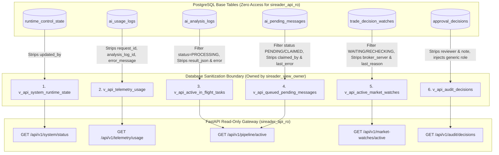

# SIREADER Phase 3.1 — Batch 2 Architecture & API Contract
## Spesifikasi Desain & Kontrak API Observabilitas Read-Only (Revised Contract)

- **Status Dokumen:** `APPROVED FOR IMPLEMENTATION PLANNING` (Design-Only Revision)
- **Target Role Pelaksana:** Argon (Backend Developer — Batch 2 Implementation)
- **Target Repository:** `awandhani22-boop/SIREADER-Python-Backend`
- **Target Branch:** `phase-3-1-api-gateway`
- **Referensi Arsitektur Induk:** `docs/PHASE_3_ARCHITECTURE.md` (Commit `223d592` pada repo Virtual Office)
- **Prinsip Utama:** 100% Read-Only Observability, Database Boundary Sanitization, Zero Direct Base Table Access, Zero Synthetic Data, Non-Fabricated Liveness.

---

## 1. Tujuan dan Batas Lingkup Batch 2

### 1.1 Tujuan
Dokumen ini menetapkan spesifikasi arsitektur final, kontrak skema data (Pydantic DTO), spesifikasi **6 Database Views**, perancangan kueri database read-only, dan matriks sanitasi privasi untuk implementasi **Batch 2: Python Read-Only API Gateway** yang akan dikerjakan oleh **Argon**.

### 1.2 Batasan Arsitektur Keras (Architectural Boundaries)
Sesuai ketetapan *Phase 3.0 Architecture Freeze*, batasan berikut bersifat mutlak dan dilarang dilanggar oleh implementasi Batch 2:

1. **Eksklusif HTTP GET:** Seluruh endpoint API beroperasi hanya dengan metode `GET`. Dilarang menyediakan endpoint `POST`, `PUT`, `PATCH`, atau `DELETE`.
2. **Nol Mutasi Bisnis:** API Gateway dilarang menyediakan endpoint untuk menyetujui (*approval*), menolak (*reject*), menjeda (*pause*), melanjutkan (*resume*), mengubah konfigurasi runtime, maupun mengeksekusi order trading ke MetaTrader 5 (MT5).
3. **Isolasi Proses OS Mandiri:** API Gateway berjalan sebagai proses terpisah dari daemon utama `app.main:run_sireader`. Pada tahap awal, Uvicorn dijalankan dengan **satu worker process** (`workers = 1`).
4. **Larangan Mengaktifkan Listener/Bot Tambahan:** API Gateway dilarang mengimpor atau menjalankan Telethon Telegram Listener, python-telegram-bot Approver Updater, poller background MT5, atau worker outbox.
5. **Autentikasi Bearer Wajib (Fail-Closed):** Seluruh endpoint mewajibkan header `Authorization: Bearer <token>`. Jika token salah, hilang, atau server token belum dikonfigurasi, API menolak request secara *fail-closed* (`HTTP 401 Unauthorized` atau `500 Configuration Error`).
6. **Koneksi Database Read-Only Terisolasi:** API Gateway hanya menggunakan koneksi `SIREADER_API_DATABASE_URL` dengan role PostgreSQL `sireader_api_ro`. Dilarang keras menggunakan fallback ke `DATABASE_URL` utama.
7. **Isolasi Akses Database Melalui Views (Zero Base Table SELECT):** Route handler API Gateway **dilarang mengeksekusi kueri langsung terhadap tabel dasar**. Seluruh pembacaan data wajib dilakukan melalui **6 SQL View** yang disetujui (`v_api_*`). Role `sireader_api_ro` tidak diberikan izin `SELECT` pada tabel dasar.
8. **Bebas Data Sintetis & Penipuan Status:** API dilarang mengarang nilai konfigurasi (misal mengklaim `auto_paused=False` jika tabel kosong) dan dilarang memalsukan status *heartbeat* worker OS jika faktanya belum ada mekanisme denyut nadi periodik.

---

## 2. Audit Sumber Data Aktual & Diskrepansi Model

Pemeriksaan mendalam terhadap source code aktual di `C:\SIREADER` (`app/database/models.py`, `migrations/`, `app/ai/`, `app/signals/`, `app/approval/`) mengungkap sejumlah fakta teknis dan diskrepansi fatal antara asumsi dokumen Phase 3.0 lama dengan model database riil:

### 2.1 Diskrepansi Fatal SQL Views Lama (docs/PHASE_3_ARCHITECTURE.md)
Rancangan SQL View pada dokumen Phase 3.0 lama mengandung banyak kolom fiktif yang tidak pernah ada di model SQLAlchemy maupun migrasi PostgreSQL Supabase:

| Nama View Draft Lama | Kolom Draft Lama | Status di Model Riil (`app/database/models.py`) | Koreksi Kolom Aktual |
|---|---|---|---|
| `v_api_telegram_messages` | `message_id` | **TIDAK ADA** | Kolom aktual: `telegram_message_id` (BigInteger) |
| `v_api_telegram_messages` | `date` | **TIDAK ADA** | Kolom aktual: `telegram_date` (DateTime nullable) |
| `v_api_telegram_messages` | `text` | **TIDAK ADA** | Kolom aktual: `message_text` (Text nullable) |
| `v_api_telegram_messages` | `channel_name` | **TIDAK ADA** | Tidak ada kolom channel_name (hanya ada `sender` & `chat_id`) |
| `v_api_telegram_messages` | `created_at` | **TIDAK ADA** | Kolom aktual: `received_at` (DateTime) |
| `v_api_ai_analysis_logs` | `message_id` | **TIDAK ADA** | Kolom aktual: `target_message_id` (BigInteger) |
| `v_api_ai_analysis_logs` | `tier` | **TIDAK ADA DI TABEL INI** | `tier` berada di `ai_usage_logs`, bukan `ai_analysis_logs` |
| `v_api_ai_analysis_logs` | `retry_count` | **TIDAK ADA DI TABEL INI** | Kolom `attempts` berada di `ai_pending_messages` |
| `v_api_ai_analysis_logs` | `latency_ms` | **TIDAK ADA** | Latensi tidak disimpan sebagai kolom database |
| `v_api_ai_analysis_logs` | `updated_at` | **TIDAK ADA** | Tabel ini **HANYA** memiliki `created_at` dan `completed_at` |
| `v_api_trade_decision_watches` | `message_id` | **TIDAK ADA** | Berelasi via `analysis_log_id` & `trade_episode_id` |
| `v_api_trade_decision_watches` | `epic` | **TIDAK ADA** | Kolom aktual: `symbol` (String(64)) |
| `v_api_trade_decision_watches` | `direction` | **TIDAK ADA DI TABEL INI** | `direction` berada di `trade_episodes` / `trade_pending_entries` |
| `v_api_trade_decision_watches` | `target_spread` | **TIDAK ADA** | Kolom aktual: `maximum_spread_pips` (Numeric(18,5)) |
| `v_api_trade_decision_watches` | `last_spread` | **TIDAK ADA** | Kolom aktual: `spread_pips` (Numeric(18,5)) |

### 2.2 Fakta Teknis Model Database Aktual

1. **`RuntimeControlState` (`app/database/models.py:851`):**
   - Kolom: `id` (int PK), `execution_mode` (varchar(20), default `'APPROVAL'`), `trading_mode` (varchar(20), default `'DRY_RUN'`), `auto_execution_enabled` (bool, default `False`), `auto_paused` (bool, default `True`), `updated_by` (bigint nullable), `updated_at` (timestamptz).
   - Catatan: Menampung 1 baris kontrol (`id = 1`). Jika tabel kosong, status sistem harus dilaporkan sebagai `STATE_UNAVAILABLE` / `UNKNOWN`, dilarang membuat default buatan.
2. **`AIUsageLog` (`app/database/models.py:598` & `migrations/2026_11_04_anthropic_usd_billing.sql`):**
   - Kolom: `id`, `request_id`, `usage_date` (Date), `provider`, `model`, `tier`, `input_tokens`, `output_tokens`, `cache_read_tokens`, `cache_write_tokens`, `cache_write_5m_tokens`, `cache_write_1h_tokens`, `thinking_tokens`, `cache_ttl_estimated`, `billing_currency` (varchar(3)), `cost_rp` (numeric(18,6)), `reserved_rp` (numeric(18,6)), `cost_usd` (numeric(18,6)), `reserved_usd` (numeric(18,6)), `analysis_log_id` (int nullable), `status` (varchar(20)), `error_message`, `created_at`, `completed_at`.
   - Catatan: Data lama sebelum migrasi memiliki kemungkinan `billing_currency IS NULL`. View wajib menangani dengan `COALESCE(billing_currency, 'IDR')`. IDR dan USD **DILARANG DIJUMLAHKAN**.
3. **`AIAnalysisLog` (`app/database/models.py:737`):**
   - Kolom: `id`, `chat_id`, `target_message_id`, `status` (varchar(40)), `result_json` (Text nullable), `error_message` (Text nullable), `created_at`, `completed_at`.
   - Catatan: **TIDAK MEMILIKI `updated_at`**. Status aktif saat inferensi adalah `'PROCESSING'`.
4. **`AIPendingMessage` (`app/database/models.py:1116`):**
   - Kolom: `id`, `dedup_key`, `chat_id`, `telegram_message_id`, `analysis_log_id`, `status` (varchar(20)), `reason`, `attempts`, `claimed_by`, `claimed_at`, `next_attempt_at`, `last_error`, `created_at`, `updated_at`.
   - Catatan: Menampung pesan yang tertunda akibat budget habis (`BLOCKED_HARD_BUDGET`, `MANUAL_REVIEW_BUDGET`).
5. **`TradeDecisionWatch` (`app/database/models.py:217`):**
   - Kolom: `id`, `analysis_log_id`, `trade_episode_id`, `symbol`, `broker_server`, `status` (varchar(32)), `spread_pips`, `maximum_spread_pips`, `last_bid`, `last_ask`, `last_checked_at`, `next_check_at`, `check_count`, `last_reason`, `created_at`, `updated_at`, `resolved_at`.
   - Catatan: Status aktif yang dipantau adalah `WAITING_FOR_SPREAD` dan `RECHECKING`.
6. **`ApprovalDecision` (`app/database/models.py:794`):**
   - Kolom: `id`, `analysis_log_id`, `previous_status`, `decision`, `new_status`, `reviewer`, `note`, `created_at`.
   - Catatan: Audit trail persetujuan manusia dari Telegram bot.

---

## 3. Arsitektur Enam Database Views (Database Boundary Sanitization)

Untuk menegakkan isolasi keamanan tingkat database, seluruh sanitasi privasi diterapkan **pada level SQL View**, sehingga data sensitif tidak pernah keluar dari batas database ke memori API.

Desain arsitektur menetapkan **ENAM (6) VIEW DATABASE**:



---

### 3.1 Spesifikasi DDL Enam SQL Views

```sql
-- ============================================================
-- SIREADER OBSERVABILITY VIEWS (6 VIEWS SPECIFICATION)
-- CATATAN: DOKUMEN DESAIN ONLY. DILARANG DIEKSEKUSI SEKARANG.
-- ============================================================

-- ------------------------------------------------------------
-- 1. View Runtime State
-- Sumber: runtime_control_state
-- Sanitasi: Mengecualikan updated_by (Telegram User ID)
-- ------------------------------------------------------------
CREATE OR REPLACE VIEW v_api_system_runtime_state AS
    SELECT 
        id,
        execution_mode,
        trading_mode,
        auto_execution_enabled,
        auto_paused,
        updated_at
    FROM public.runtime_control_state;

-- ------------------------------------------------------------
-- 2. View Telemetry Usage
-- Sumber: ai_usage_logs
-- Sanitasi:
--   - Mengecualikan id, request_id, analysis_log_id, error_message,
--     cache_write_5m_tokens, cache_write_1h_tokens, cache_ttl_estimated
--   - Menangani konsistensi data lama: COALESCE(billing_currency, 'IDR')
-- ------------------------------------------------------------
CREATE OR REPLACE VIEW v_api_telemetry_usage AS
    SELECT 
        usage_date,
        provider,
        model,
        tier,
        input_tokens,
        output_tokens,
        cache_read_tokens,
        cache_write_tokens,
        thinking_tokens,
        COALESCE(billing_currency, 'IDR')::varchar(3) AS billing_currency,
        cost_rp,
        reserved_rp,
        cost_usd,
        reserved_usd,
        status,
        created_at,
        completed_at
    FROM public.ai_usage_logs;

-- ------------------------------------------------------------
-- 3. View Active In-Flight Pipeline Tasks
-- Sumber: ai_analysis_logs
-- Sanitasi:
--   - Filter ketat: HANYA baris status = 'PROCESSING'
--   - Mengecualikan chat_id, target_message_id, result_json, error_message
--   - Proyeksi boolean has_checkpoint tanpa mengekspos isi payload
-- ------------------------------------------------------------
CREATE OR REPLACE VIEW v_api_active_in_flight_tasks AS
    SELECT 
        id AS analysis_log_id,
        status,
        created_at,
        EXTRACT(EPOCH FROM (now() - created_at)) AS elapsed_seconds,
        (result_json IS NOT NULL) AS has_checkpoint
    FROM public.ai_analysis_logs
    WHERE status = 'PROCESSING';

-- ------------------------------------------------------------
-- 4. View Queued Messages (Budget Blocked)
-- Sumber: ai_pending_messages
-- Sanitasi:
--   - Filter ketat: HANYA status IN ('PENDING', 'CLAIMED')
--   - Mengecualikan dedup_key, chat_id, telegram_message_id, 
--     analysis_log_id, claimed_by, last_error, next_attempt_at
--   - Menggunakan reason sebagai stable allowlisted error code
-- ------------------------------------------------------------
CREATE OR REPLACE VIEW v_api_queued_pending_messages AS
    SELECT 
        id AS pending_id,
        status,
        reason AS queue_reason,
        attempts,
        claimed_at,
        created_at,
        updated_at
    FROM public.ai_pending_messages
    WHERE status IN ('PENDING', 'CLAIMED');

-- ------------------------------------------------------------
-- 5. View Active Spread Watches
-- Sumber: trade_decision_watches
-- Sanitasi:
--   - Filter ketat: HANYA status IN ('WAITING_FOR_SPREAD', 'RECHECKING')
--   - Mengecualikan analysis_log_id, trade_episode_id, broker_server,
--     last_reason, resolved_at
-- ------------------------------------------------------------
CREATE OR REPLACE VIEW v_api_active_market_watches AS
    SELECT 
        id AS watch_id,
        symbol,
        status,
        spread_pips,
        maximum_spread_pips,
        last_bid,
        last_ask,
        check_count,
        last_checked_at,
        next_check_at,
        created_at,
        updated_at
    FROM public.trade_decision_watches
    WHERE status IN ('WAITING_FOR_SPREAD', 'RECHECKING');

-- ------------------------------------------------------------
-- 6. View Audit Decisions
-- Sumber: approval_decisions
-- Sanitasi:
--   - Mengecualikan reviewer (Telegram User/Username) dan note (internal note)
--   - Memproyeksikan label peran generik langsung di level database view
-- ------------------------------------------------------------
CREATE OR REPLACE VIEW v_api_audit_decisions AS
    SELECT 
        id AS audit_id,
        analysis_log_id,
        decision,
        previous_status,
        new_status,
        'Authorized Approver'::varchar(50) AS reviewer_role,
        created_at AS decided_at
    FROM public.approval_decisions;
```

---

### 3.2 Analisis Keamanan Role Kepemilikan View (Role Security Hardening)

#### Koreksi Fundamental:
Dokumen lama mengasumsikan bahwa kepemilikan view oleh `postgres` membuat view "terlindungi secara matematis". **Klaim tersebut salah dan berbahaya**, karena `postgres` adalah superuser yang mengabaikan Row-Level Security (RLS) dan memiliki wewenang penuh tanpa batas. Jika view dibuat oleh superuser, konteks eksekusi view definer dapat membocorkan privilege eskalasi secara tidak sengaja.

#### Model Arsitektur Role View yang Direkomendasikan:
Untuk menegakkan isolasi hak akses minimum (*Principle of Least Privilege*), rancangan menetapkan pembagian 2 role database:

```text
+------------------------------------------------------------------------------------+
|               PEMBAGIAN ROLE DATABASE KHUSUS OBSERVABILITAS                       |
+------------------------------------------------------------------------------------+
| 1. Role Pemilik View: 'sireader_view_owner'                                        |
|    - Atribut: NOLOGIN, NOSUPERUSER, NOCREATEDB, NOCREATEROLE, NOREPLICATION,      |
|               NOBYPASSRLS, NOINHERIT                                               |
|    - Kepemilikan: Pemilik 6 objek View (v_api_*). BUKAN pemilik tabel dasar.       |
|    - Privilege: Diberikan GRANT SELECT HANYA pada kolom-kolom yang didefinisikan   |
|                 di dalam 6 View (Column-Level Grant pada tabel dasar).             |
|                                                                                    |
| 2. Role Akses API Gateway: 'sireader_api_ro'                                       |
|    - Atribut: LOGIN, NOSUPERUSER, NOCREATEDB, NOCREATEROLE, NOREPLICATION,        |
|               NOBYPASSRLS, NOINHERIT                                               |
|    - Privilege: Diberikan GRANT SELECT HANYA pada 6 View (v_api_*).                |
|    - Hak Tabel Dasar: ZERO PRIVILEGES (REVOKE ALL ON BASE TABLES).                 |
+------------------------------------------------------------------------------------+
```

#### Evaluasi Default View Security (Definer) vs `security_invoker = true`:
1. **Model `security_invoker = true` (PostgreSQL 15+):**
   - Jika view menggunakan `WITH (security_invoker = true)`, PostgreSQL mengevaluasi hak akses tabel dasar berdasarkan pengguna pemanggil (*invoker*), yaitu `sireader_api_ro`.
   - **Konsekuensi:** `sireader_api_ro` **harus diberikan izin SELECT pada tabel dasar**. Jika izin tabel dasar diberikan, maka proteksi view menjadi rapuh karena jika ada celah injection atau query kustom, `sireader_api_ro` dapat membaca tabel dasar langsung.
2. **Model Default View Security (Definer Mode dengan Non-Superuser Owner):**
   - View dibuat oleh `sireader_view_owner` (non-superuser, non-login).
   - Hak akses tabel dasar hanya dimiliki oleh `sireader_view_owner`.
   - `sireader_api_ro` hanya memiliki hak membaca view.
   - **Hasil:** `sireader_api_ro` tidak dapat menyentuh tabel dasar sama sekali. Jika mencoba `SELECT * FROM public.approval_decisions;`, database PostgreSQL langsung menolak dengan:
     `ERROR: permission denied for table approval_decisions`.
3. **Peringatan Verifikasi Empiris:**
   - Desain ini **TIDAK BOLEH DIKLAIM AMAN** sebelum diuji dan diverifikasi secara langsung pada instance PostgreSQL Supabase riil pada Milestone 3.1.
   - Skrip SQL verifikasi hak akses pada `docs/PHASE_3_ARCHITECTURE.md:128-141` tetap menjadi syarat kelulusan audit empiris.

---

## 4. Mekanisme Kueri View oleh Argon

Argon wajib mengimplementasikan seluruh pembacaan data di `app/api/` **HANYA melalui 6 View yang disetujui**. Dilarang mengimpor model ORM dari `app/database/models.py` untuk eksekusi kueri pada route handler.

### 4.1 Deklarasi View Models (`app/api/views.py`)
Argon akan mendefinisikan mapping deklaratif khusus untuk ke-6 View menggunakan SQLAlchemy `Table` atau class deklaratif ringan:

```python
"""Definisi skema View SQL untuk SIREADER Read-Only API Gateway.

Seluruh entitas di modul ini terikat pada database views (v_api_*),
BUKAN pada tabel dasar berizin tulis.
"""

from sqlalchemy import MetaData, Table, Column, Integer, String, Boolean, DateTime, Date, Numeric

metadata = MetaData()

# 1. View Runtime State
v_api_system_runtime_state = Table(
    "v_api_system_runtime_state",
    metadata,
    Column("id", Integer, primary_key=True),
    Column("execution_mode", String),
    Column("trading_mode", String),
    Column("auto_execution_enabled", Boolean),
    Column("auto_paused", Boolean),
    Column("updated_at", DateTime(timezone=True)),
)

# 2. View Telemetry Usage
v_api_telemetry_usage = Table(
    "v_api_telemetry_usage",
    metadata,
    Column("usage_date", Date),
    Column("provider", String),
    Column("model", String),
    Column("tier", String),
    Column("input_tokens", Integer),
    Column("output_tokens", Integer),
    Column("cache_read_tokens", Integer),
    Column("cache_write_tokens", Integer),
    Column("thinking_tokens", Integer),
    Column("billing_currency", String),
    Column("cost_rp", Numeric(18, 6)),
    Column("reserved_rp", Numeric(18, 6)),
    Column("cost_usd", Numeric(18, 6)),
    Column("reserved_usd", Numeric(18, 6)),
    Column("status", String),
    Column("created_at", DateTime(timezone=True)),
    Column("completed_at", DateTime(timezone=True)),
)

# 3. View In-Flight Tasks
v_api_active_in_flight_tasks = Table(
    "v_api_active_in_flight_tasks",
    metadata,
    Column("analysis_log_id", Integer, primary_key=True),
    Column("status", String),
    Column("created_at", DateTime(timezone=True)),
    Column("elapsed_seconds", Numeric),
    Column("has_checkpoint", Boolean),
)

# 4. View Queued Messages
v_api_queued_pending_messages = Table(
    "v_api_queued_pending_messages",
    metadata,
    Column("pending_id", Integer, primary_key=True),
    Column("status", String),
    Column("queue_reason", String),
    Column("attempts", Integer),
    Column("claimed_at", DateTime(timezone=True)),
    Column("created_at", DateTime(timezone=True)),
    Column("updated_at", DateTime(timezone=True)),
)

# 5. View Active Market Watches
v_api_active_market_watches = Table(
    "v_api_active_market_watches",
    metadata,
    Column("watch_id", Integer, primary_key=True),
    Column("symbol", String),
    Column("status", String),
    Column("spread_pips", Numeric(18, 5)),
    Column("maximum_spread_pips", Numeric(18, 5)),
    Column("last_bid", Numeric(18, 5)),
    Column("last_ask", Numeric(18, 5)),
    Column("check_count", Integer),
    Column("last_checked_at", DateTime(timezone=True)),
    Column("next_check_at", DateTime(timezone=True)),
    Column("created_at", DateTime(timezone=True)),
    Column("updated_at", DateTime(timezone=True)),
)

# 6. View Audit Decisions
v_api_audit_decisions = Table(
    "v_api_audit_decisions",
    metadata,
    Column("audit_id", Integer, primary_key=True),
    Column("analysis_log_id", Integer),
    Column("decision", String),
    Column("previous_status", String),
    Column("new_status", String),
    Column("reviewer_role", String),
    Column("decided_at", DateTime(timezone=True)),
)
```

---

## 5. Kontrak Lima Endpoint & Pemetaan ke Enam View

```text
+------------------------------------+---------------------------------------+
| ENDPOINT HTTP (GET ONLY)           | DATABASE VIEW YANG DIKONSUMSI         |
+------------------------------------+---------------------------------------+
| 1. /api/v1/system/status           | v_api_system_runtime_state            |
| 2. /api/v1/telemetry/usage         | v_api_telemetry_usage                 |
| 3. /api/v1/pipeline/active         | v_api_active_in_flight_tasks DAN      |
|                                    | v_api_queued_pending_messages         |
| 4. /api/v1/market-watches/active   | v_api_active_market_watches           |
| 5. /api/v1/audit/decisions         | v_api_audit_decisions                 |
+------------------------------------+---------------------------------------+
```

---

### 5.1 Endpoint 1: `GET /api/v1/system/status`
- **View Sumber:** `v_api_system_runtime_state`.
- **Kueri:**
  ```python
  stmt = select(v_api_system_runtime_state).order_by(v_api_system_runtime_state.c.id.asc()).limit(1)
  row = session.execute(stmt).mappings().first()
  ```
- **Penanganan Nullable & Fallback:**
  - Jika `row is None`: Mengembalikan `runtime_control = None`. Dilarang mengisi nilai konfigurasi default sintetis.

#### Pydantic Schema (`SystemStatusResponse`)
```python
from datetime import datetime
from typing import Literal
from pydantic import BaseModel, Field

class RuntimeControlDTO(BaseModel):
    execution_mode: str = Field(description="Mode eksekusi: APPROVAL / AUTO")
    trading_mode: str = Field(description="Mode trading: DRY_RUN / LIVE")
    auto_execution_enabled: bool = Field(description="Apakah auto trading diaktifkan")
    auto_paused: bool = Field(description="Apakah safety pause aktif")
    updated_at: datetime = Field(description="Timestamp pembaruan konfigurasi")

class SystemStatusResponse(BaseModel):
    api_status: Literal["HEALTHY", "DEGRADED"] = Field(default="HEALTHY")
    database_status: Literal["CONNECTED", "DISCONNECTED"] = Field(description="Status konektivitas database read-only")
    server_time_utc: datetime = Field(description="Waktu server API (UTC)")
    runtime_control: RuntimeControlDTO | None = Field(default=None, description="Snapshot kontrol sistem")
    process_monitoring_note: str = Field(
        default="Worker OS liveness is unmonitored; backend currently lacks persistent heartbeats."
    )
```

---

### 5.2 Endpoint 2: `GET /api/v1/telemetry/usage`
- **View Sumber:** `v_api_telemetry_usage`.
- **Aturan Agregasi:**
  - IDR dan USD **TIDAK BOLEH DIJUMLAHKAN**.
  - Tanggal evaluasi mengikuti zona waktu `Asia/Jakarta`.
  - Mengelompokkan berdasarkan `billing_currency`.
- **Kueri:**
  ```python
  stmt = (
      select(
          v_api_telemetry_usage.c.billing_currency,
          func.coalesce(func.sum(v_api_telemetry_usage.c.cost_rp), 0).label("total_cost_rp"),
          func.coalesce(func.sum(v_api_telemetry_usage.c.reserved_rp), 0).label("total_reserved_rp"),
          func.coalesce(func.sum(v_api_telemetry_usage.c.cost_usd), 0).label("total_cost_usd"),
          func.coalesce(func.sum(v_api_telemetry_usage.c.reserved_usd), 0).label("total_reserved_usd"),
          func.coalesce(func.sum(v_api_telemetry_usage.c.input_tokens), 0).label("total_input"),
          func.coalesce(func.sum(v_api_telemetry_usage.c.output_tokens), 0).label("total_output"),
          func.coalesce(func.sum(v_api_telemetry_usage.c.cache_read_tokens), 0).label("total_cache_read"),
          func.coalesce(func.sum(v_api_telemetry_usage.c.cache_write_tokens), 0).label("total_cache_write"),
          func.coalesce(func.sum(v_api_telemetry_usage.c.thinking_tokens), 0).label("total_thinking"),
          func.count().label("total_requests"),
      )
      .where(
          v_api_telemetry_usage.c.usage_date >= start_date,
          v_api_telemetry_usage.c.usage_date <= end_date,
      )
      .group_by(v_api_telemetry_usage.c.billing_currency)
  )
  ```

#### Pydantic Schema (`TelemetryUsageResponse`)
```python
from datetime import date
from decimal import Decimal
from typing import Dict, List
from pydantic import BaseModel, Field

class TokenBreakdownDTO(BaseModel):
    input_tokens: int = Field(default=0)
    output_tokens: int = Field(default=0)
    cache_read_tokens: int = Field(default=0)
    cache_write_tokens: int = Field(default=0)
    thinking_tokens: int = Field(default=0)

class CurrencyTelemetryDTO(BaseModel):
    currency: str = Field(description="IDR atau USD")
    total_cost: Decimal = Field(description="Biaya aktual yang telah dibebankan")
    total_reserved: Decimal = Field(description="Biaya reservasi in-flight")
    total_projected: Decimal = Field(description="Total aktual + reservasi")
    total_requests: int = Field(description="Total permintaan AI")
    tokens: TokenBreakdownDTO = Field(description="Rincian token")
    status_counts: Dict[str, int] = Field(description="Distribusi status request")

class ModelTelemetryDTO(BaseModel):
    model: str = Field(description="Nama model AI")
    tier: str = Field(description="Tier inferensi: FAST / REASONING / ESCALATION")
    currency: str = Field(description="IDR atau USD")
    requests: int = Field(default=0)
    cost: Decimal = Field(description="Biaya aktual")
    tokens: TokenBreakdownDTO = Field(description="Rincian token")

class TelemetryUsageResponse(BaseModel):
    period_start: date = Field(description="Awal rentang (Asia/Jakarta)")
    period_end: date = Field(description="Akhir rentang (Asia/Jakarta)")
    period_days: int = Field(description="Jumlah hari")
    currencies: List[CurrencyTelemetryDTO] = Field(description="Agregasi per mata uang")
    models: List[ModelTelemetryDTO] = Field(description="Rincian per model")
```

---

### 5.3 Endpoint 3: `GET /api/v1/pipeline/active`
- **Views Sumber:**
  1. `v_api_active_in_flight_tasks`
  2. `v_api_queued_pending_messages`
- **Semantik Liveness:**
  - `status = 'PROCESSING'` hanya menunjukkan record berada pada status tersebut di database.
  - `elapsed_seconds` dihitung dari `created_at` untuk mengukur usia record, **bukan detak heartbeat worker**.
  - `claimed_at` pada queued messages hanya menunjukkan klaim antrean, bukan bukti proses OS hidup.
- **Kueri:**
  ```python
  stmt_inflight = select(v_api_active_in_flight_tasks).order_by(v_api_active_in_flight_tasks.c.created_at.asc()).limit(limit)
  stmt_queued = select(v_api_queued_pending_messages).order_by(v_api_queued_pending_messages.c.created_at.asc()).limit(limit)
  ```

#### Pydantic Schema (`ActivePipelineResponse`)
```python
from datetime import datetime
from typing import List, Literal
from pydantic import BaseModel, Field

class InFlightAnalysisDTO(BaseModel):
    analysis_log_id: int = Field(description="ID catatan analisis")
    status: Literal["PROCESSING"] = Field(default="PROCESSING")
    created_at: datetime = Field(description="Waktu task mulai dibuat (UTC)")
    elapsed_seconds: float = Field(description="Usia record sejak created_at dalam detik")
    has_checkpoint: bool = Field(description="Apakah checkpoint parsial tersedia")

class QueuedMessageDTO(BaseModel):
    pending_id: int = Field(description="ID antrean pesan pending")
    status: Literal["PENDING", "CLAIMED"] = Field(description="Status antrean")
    queue_reason: str | None = Field(default=None, description="Kode alasan antrean allowlisted (mis: BLOCKED_HARD_BUDGET)")
    attempts: int = Field(default=0, description="Jumlah percobaan pemrosesan")
    claimed_at: datetime | None = Field(default=None, description="Waktu terakhir klaim antrean")
    created_at: datetime = Field(description="Waktu masuk antrean")
    updated_at: datetime = Field(description="Waktu pembaruan status antrean")

class ActivePipelineResponse(BaseModel):
    server_time_utc: datetime = Field(description="Waktu server evaluasi")
    total_in_flight: int = Field(description="Jumlah task PROCESSING aktif")
    total_queued: int = Field(description="Jumlah pesan tertunda")
    in_flight_tasks: List[InFlightAnalysisDTO] = Field(description="Daftar analisis in-flight")
    queued_messages: List[QueuedMessageDTO] = Field(description="Daftar antrean pesan tertunda")
```

---

### 5.4 Endpoint 4: `GET /api/v1/market-watches/active`
- **View Sumber:** `v_api_active_market_watches`.
- **Kueri:**
  ```python
  stmt = (
      select(v_api_active_market_watches)
      .order_by(v_api_active_market_watches.c.next_check_at.asc())
      .limit(limit)
  )
  ```

#### Pydantic Schema (`ActiveMarketWatchesResponse`)
```python
from datetime import datetime
from decimal import Decimal
from typing import List, Literal
from pydantic import BaseModel, Field

class MarketWatchItemDTO(BaseModel):
    watch_id: int = Field(description="ID pengawasan spread")
    symbol: str = Field(description="Simbol instrumen (mis: XAUUSD)")
    status: Literal["WAITING_FOR_SPREAD", "RECHECKING"] = Field(description="Status pengawasan aktif")
    spread_pips: Decimal | None = Field(default=None, description="Spread pips terakhir yang teramati")
    maximum_spread_pips: Decimal = Field(description="Batas spread maksimal yang diizinkan")
    last_bid: Decimal | None = Field(default=None, description="Harga Bid terakhir")
    last_ask: Decimal | None = Field(default=None, description="Harga Ask terakhir")
    check_count: int = Field(default=0, description="Jumlah siklus pengecekan yang telah berjalan")
    last_checked_at: datetime | None = Field(default=None, description="Waktu pengecekan terakhir")
    next_check_at: datetime = Field(description="Jadwal pengecekan berikutnya")
    created_at: datetime = Field(description="Waktu watch dibuat")

class ActiveMarketWatchesResponse(BaseModel):
    server_time_utc: datetime = Field(description="Waktu server saat respons")
    total_active_watches: int = Field(description="Total watch aktif")
    watches: List[MarketWatchItemDTO] = Field(description="Daftar pemantau spread aktif")
```

---

### 5.5 Endpoint 5: `GET /api/v1/audit/decisions`
- **View Sumber:** `v_api_audit_decisions`.
- **Sanitasi Privasi:**
  - `reviewer_role` sudah diproyeksikan sebagai `'Authorized Approver'` di level view.
  - `note` **dikecualikan dari view dan DTO** untuk mencegah kebocoran pesan internal.
- **Kueri:**
  ```python
  stmt = (
      select(v_api_audit_decisions)
      .order_by(v_api_audit_decisions.c.decided_at.desc())
      .limit(limit)
      .offset(offset)
  )
  ```

#### Pydantic Schema (`AuditDecisionsResponse`)
```python
from datetime import datetime
from typing import List, Literal
from pydantic import BaseModel, Field

class AuditDecisionItemDTO(BaseModel):
    audit_id: int = Field(description="ID rekaman audit keputusan")
    analysis_log_id: int = Field(description="ID analisis terkait")
    decision: Literal["APPROVED", "REJECTED"] = Field(description="Keputusan yang diambil")
    previous_status: str = Field(description="Status sebelum keputusan (mis: MANUAL_REVIEW)")
    new_status: str = Field(description="Status setelah keputusan (mis: APPROVED / REJECTED)")
    reviewer_role: str = Field(default="Authorized Approver", description="Identitas peran teranonimasi")
    decided_at: datetime = Field(description="Waktu keputusan ditetapkan (UTC)")

class AuditDecisionsResponse(BaseModel):
    server_time_utc: datetime = Field(description="Waktu server saat respons")
    total_returned: int = Field(description="Jumlah record yang dikembalikan")
    offset: int = Field(description="Posisi offset pagination")
    decisions: List[AuditDecisionItemDTO] = Field(description="Daftar audit keputusan")
```

---

## 6. Audit Keamanan Autentikasi (`verify_api_token`)

Audit terhadap fungsi verifikasi token di [`app/api/security.py`](file:///C:/SIREADER/app/api/security.py):

```python
def verify_api_token(provided_token: str | None, expected_token: str) -> bool:
    if not provided_token or not expected_token:
        return False
    return secrets.compare_digest(provided_token.strip(), expected_token.strip())
```

### Temuan Kritis:
1. **Normalisasi Token Server:** `expected_token` yang dimuat dari variabel environment `.env` boleh dinormalisasi via `.strip()` saat inisialisasi di `api_settings.get_api_auth_token()` untuk mencegah trailing newline atau whitespace file.
2. **Kerapuhan `provided_token.strip()`:**
   - Melakukan `.strip()` pada `provided_token` mengubah nilai kredensial yang dikirim oleh pengguna. Jika pengguna mengirim token dengan spasi tambahan (`"Bearer secret "`), token tersebut seharusnya dianggap **TIDAK COCOK** dan ditolak.
   - Mengubah kredensial yang masuk dapat memicu celah verifikasi longgar.
3. **Instruksi Perbaikan untuk Argon pada Batch 2:**
   Argon wajib memperbarui `verify_api_token()` agar **TIDAK melakukan `.strip()` pada `provided_token`**:
   ```python
   def verify_api_token(provided_token: str | None, expected_token: str) -> bool:
       """Memverifikasi token autentikasi menggunakan exact constant-time comparison."""
       if not provided_token or not expected_token:
           return False
       # provided_token dibandingkan secara persis tanpa modifikasi whitespace
       return secrets.compare_digest(provided_token, expected_token)
   ```
4. **Kasus Uji Wajib (Unit Test Matrix):**
   - Exact match -> `True`
   - Token salah -> `False`
   - Token kosong (`""`) -> `False`
   - Token `None` -> `False`
   - Token dengan spasi depan/belakang (`" token"`, `"token "`) -> `False`

---

## 7. Freshness & Liveness Semantics

API Gateway dan Virtual Office menerapkan **6 Status Visual Resmi** yang terikat pada bukti nyata data, bukan spekulasi:

```text
+-------------------+---------------------------------------+----------------------------------+
| STATUS SISTEM     | STATUS VISUAL 3D                      | ARTI & PRESENTASI                |
+-------------------+---------------------------------------+----------------------------------+
| In-flight Update  | BUSY (Inferred, Unconfirmed Heartbeat)| Task aktif < 120s, avatar kerja  |
| In-flight Lambat  | LINGERING (Latency Warning)           | Task aktif 121–180s, amber kedip |
| In-flight Mandek  | STALE (In-flight Timeout Alert)       | Task aktif > 180s, badge macet   |
| Tidak ada task    | QUIET (Business Idle - BUKAN STALE)   | Normal tenang, avatar standby    |
| Transport Putus   | DISCONNECTED                          | Transport HTTP/SSE terputus      |
| Database Down     | DB_UNAVAILABLE                        | Gagal kontak ke Supabase         |
| Anomali Data      | UNKNOWN                               | Parsing JSON gagal / data rusak  |
+-------------------+---------------------------------------+----------------------------------+
```

### Aturan Diagnostik Mutlak:
1. **Ketiadaan Task Bukan Stale:** Jika tidak ada record `PROCESSING` dan tidak ada aktivitas selama 1 jam, sistem berstatus **`QUIET`**. Ketiadaan task adalah kondisi bisnis normal saat pasar tenang.
2. **Keterbatasan `AIAnalysisLog`:** Karena `ai_analysis_logs` tidak memiliki kolom `updated_at`, `elapsed_seconds` dihitung dari `created_at`. Jika ada task `PROCESSING` yang sudah berumur $> 180$ detik, task tersebut berstatus **`STALE`** (indikasi proses worker mengalami crash atau unhandled exception di masa lalu).
3. **Ketiadaan Worker Heartbeat:** Status `BUSY` selalu dinyatakan sebagai *inferred* (berdasarkan adanya record data aktif), bukan jaminan proses worker OS hidup. Dilarang mengarang heartbeat proses.

---

## 8. Matriks Lengkap Enam View, Lima Endpoint & Sanitasi

| Endpoint API | View Database Sumber | Tabel Dasar | Kolom Terpapar di View & API | Kolom Terlarang / Disanitasi dari View |
|---|---|---|---|---|
| `GET /api/v1/system/status` | `v_api_system_runtime_state` | `runtime_control_state` | `id`, `execution_mode`, `trading_mode`, `auto_execution_enabled`, `auto_paused`, `updated_at` | `updated_by` (ID Telegram operator) |
| `GET /api/v1/telemetry/usage` | `v_api_telemetry_usage` | `ai_usage_logs` | `usage_date`, `provider`, `model`, `tier`, `input_tokens`, `output_tokens`, `cache_read_tokens`, `cache_write_tokens`, `thinking_tokens`, `billing_currency`, `cost_rp`, `reserved_rp`, `cost_usd`, `reserved_usd`, `status`, `created_at`, `completed_at` | `id`, `request_id`, `analysis_log_id`, `error_message`, `cache_write_5m_tokens`, `cache_write_1h_tokens`, `cache_ttl_estimated` |
| `GET /api/v1/pipeline/active` | `v_api_active_in_flight_tasks` & `v_api_queued_pending_messages` | `ai_analysis_logs` & `ai_pending_messages` | **In-flight:** `analysis_log_id`, `status`, `created_at`, `elapsed_seconds`, `has_checkpoint`.<br>**Queued:** `pending_id`, `status`, `queue_reason`, `attempts`, `claimed_at`, `created_at`, `updated_at` | `chat_id`, `target_message_id`, `result_json`, `error_message`, `dedup_key`, `telegram_message_id`, `claimed_by`, `last_error`, `next_attempt_at` |
| `GET /api/v1/market-watches/active` | `v_api_active_market_watches` | `trade_decision_watches` | `watch_id`, `symbol`, `status`, `spread_pips`, `maximum_spread_pips`, `last_bid`, `last_ask`, `check_count`, `last_checked_at`, `next_check_at`, `created_at`, `updated_at` | `analysis_log_id`, `trade_episode_id`, `broker_server`, `last_reason`, `resolved_at` |
| `GET /api/v1/audit/decisions` | `v_api_audit_decisions` | `approval_decisions` | `audit_id`, `analysis_log_id`, `decision`, `previous_status`, `new_status`, `reviewer_role`, `decided_at` | `reviewer` (Telegram Username/ID), `note` (Catatan internal disensor penuh dari View) |

---

## 9. Security Acceptance Criteria

Implementasi Batch 2 dinyatakan lulus kriteria keamanan jika memenuhi 10 kriteria mutlak:

1. **HTTP GET Only:** 100% endpoint beroperasi hanya dengan metode `GET`.
2. **Bearer Token Mandatory:** Seluruh request tanpa header `Authorization: Bearer <token>` atau dengan token salah ditolak `HTTP 401 Unauthorized`.
3. **Exact Token Comparison:** `verify_api_token()` menggunakan perbandingan waktu-konstan persis (`secrets.compare_digest(provided_token, expected_token)`) tanpa `.strip()` pada `provided_token`.
4. **Zero Base Table SELECT:** Seluruh kueri dieksekusi HANYA pada 6 View (`v_api_*`). API Gateway tidak memiliki kueri yang membaca tabel dasar.
5. **Separation of Currencies:** IDR dan USD dilaporkan terpisah tanpa penjumlahan lintas mata uang.
6. **Asia/Jakarta Timezone Evaluation:** Evaluasi tanggal pemakaian token AI menggunakan zona waktu `Asia/Jakarta`.
7. **Zero Secrets in Public Artifacts:** Tidak ada secret token yang tercatat dalam log aplikasi atau diteruskan ke return value dependency.
8. **Isolated Connection Pool:** API Gateway hanya menggunakan pool read-only (`pool_size=2, max_overflow=0`) dengan role `sireader_api_ro`.
9. **Fail-Closed Configuration:** Jika `SIREADER_API_DATABASE_URL` atau `SIREADER_API_AUTH_TOKEN` kosong/tidak ada, aplikasi menolak beroperasi secara fail-closed.
10. **Zero Fabrications:** Tidak ada konfigurasi atau heartbeat worker fiktif yang dikarang dalam status respons.

---

## 10. Rencana Pengujian Otomatis (Test Plan untuk Argon)

Argon wajib mengimplementasikan pengujian komprehensif di `tests/api/test_endpoints.py`:

```text
+------------------------------------+---------------------------------------------------------------+
| KATEGORI TEST                      | SKENARIO UJI                                                  |
+------------------------------------+---------------------------------------------------------------+
| Autentikasi                        | 1. Request tanpa header Authorization -> 401                  |
|                                    | 2. Request dengan scheme bukan Bearer (Basic) -> 401           |
|                                    | 3. Request dengan token salah -> 401                          |
|                                    | 4. Request dengan token ber-spasi tambahan -> 401              |
|                                    | 5. Request dengan token exact match -> 200                    |
+------------------------------------+---------------------------------------------------------------+
| System Status                      | 1. Sukses dengan data runtime_control_state valid -> 200      |
|                                    | 2. Tabel runtime_control_state kosong -> 200, control = None  |
|                                    | 3. Database connection failure -> 503 Service Unavailable    |
+------------------------------------+---------------------------------------------------------------+
| Telemetry Usage                    | 1. Pemisahan IDR dan USD tanpa percampuran nilai              |
|                                    | 2. Handling COALESCE untuk data lama dengan currency NULL     |
|                                    | 3. Zero data telemetry -> 200, list kosong / total 0          |
|                                    | 4. Filter tanggal Asia/Jakarta                                |
+------------------------------------+---------------------------------------------------------------+
| Active Pipeline                    | 1. Membaca task PROCESSING dengan elapsed_seconds > 0         |
|                                    | 2. Membaca queued messages BLOCKED_HARD_BUDGET                |
|                                    | 3. Verifikasi ketiadaan result_json dan error mentah          |
+------------------------------------+---------------------------------------------------------------+
| Market Watches                     | 1. Filter status WAITING_FOR_SPREAD dan RECHECKING            |
|                                    | 2. Status RESOLVED tidak muncul                               |
|                                    | 3. Verifikasi broker_server dan last_reason tidak ada di JSON  |
+------------------------------------+---------------------------------------------------------------+
| Audit Decisions                    | 1. Verifikasi reviewer_role adalah 'Authorized Approver'      |
|                                    | 2. Verifikasi kolom note internal tidak bocor ke JSON         |
|                                    | 3. Verifikasi pagination limit & offset                       |
+------------------------------------+---------------------------------------------------------------+
```

---

## 11. Urutan Implementasi untuk Argon (Batch 2 Execution Order)

```text
+-----------------------------------------------------------------------------------+
|                   URUTAN LANGKAH IMPLEMENTASI BATCH 2 (ARGON)                     |
+-----------------------------------------------------------------------------------+
| Langkah 1: Perbarui verify_api_token() di app/api/security.py                     |
|            - Terapkan exact constant-time comparison tanpa strip(provided_token)  |
|            - Update unit test di tests/api/test_security.py                       |
+-----------------------------------------------------------------------------------+
| Langkah 2: Buat model View SQLAlchemy di app/api/views.py                         |
|            - Deklarasikan objek Table untuk ke-6 View database:                    |
|              v_api_system_runtime_state, v_api_telemetry_usage,                    |
|              v_api_active_in_flight_tasks, v_api_queued_pending_messages,         |
|              v_api_active_market_watches, v_api_audit_decisions.                  |
+-----------------------------------------------------------------------------------+
| Langkah 3: Buat modul DTO Pydantic di app/api/schemas.py                          |
|            - Definisikan SystemStatusResponse, TelemetryUsageResponse,            |
|              ActivePipelineResponse, ActiveMarketWatchesResponse,                 |
|              AuditDecisionsResponse beserta sub-modelnya.                         |
+-----------------------------------------------------------------------------------+
| Langkah 4: Buat route handlers di app/api/routes/                                 |
|            - status.py, telemetry.py, pipeline.py, market_watches.py, audit.py    |
|            - Gunakan sync 'def' handler, Depends(get_ro_session),                 |
|              dan kueri HANYA terhadap v_api_* views dari app/api/views.py.        |
+-----------------------------------------------------------------------------------+
| Langkah 5: Buat application factory di app/api/server.py                          |
|            - Inisialisasi FastAPI(docs_url="/docs", redoc_url=None)               |
|            - Pasang CORSMiddleware berdasarkan api_settings.cors_origins_list      |
|            - Daftarkan ke-5 router terproteksi verify_bearer_token                |
+-----------------------------------------------------------------------------------+
| Langkah 6: Tulis test suite komprehensif di tests/api/test_endpoints.py           |
|            - Uji kelima endpoint dengan TestClient dan mock session               |
|            - Pastikan 100% test passing                                           |
+-----------------------------------------------------------------------------------+
| Langkah 7: Jalankan regresi penuh test suite core trading                         |
|            - pytest test_decision_engine.py test_decision_service.py -v            |
|            - Verifikasi 50 passed tanpa ada interferensi atau degradasi           |
+-----------------------------------------------------------------------------------+
```

---
*Dokumen revisi arsitektur dan kontrak ini siap diserahkan kepada Argon untuk implementasi Batch 2.*
