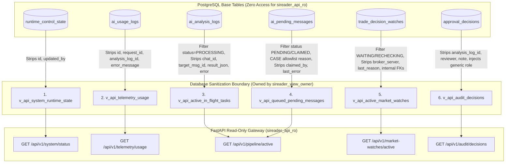

# SIREADER Phase 3.1 — Batch 2 Architecture & API Contract
## Spesifikasi Desain & Kontrak API Observabilitas Read-Only

- **Status Dokumen:** `PENDING EMPIRICAL VERIFICATION (DESIGN FREEZE - NOT IMPLEMENTATION-READY)`
- **Target Role Pelaksana:** Argon (Backend Developer — Batch 2 Implementation)
- **Target Repository:** `awandhani22-boop/SIREADER-Python-Backend`
- **Target Branch:** `phase-3-1-api-gateway`
- **Referensi Arsitektur Induk:** `docs/PHASE_3_ARCHITECTURE.md` (Commit `223d592` pada repo Virtual Office)
- **Prinsip Utama:** 100% Read-Only Observability, Database Boundary Sanitization, Zero Direct Base Table Access, Evaluated Identifier Governance, Transparent Unconfirmed Liveness.

---

## 1. Tujuan dan Batas Lingkup Batch 2

### 1.1 Tujuan
Dokumen ini menetapkan spesifikasi arsitektur final, kontrak skema data (Pydantic DTO), spesifikasi **6 Database Views**, perancangan kueri database read-only, dan matriks sanitasi privasi untuk implementasi **Batch 2: Python Read-Only API Gateway** yang akan dikerjakan oleh **Argon** setelah seluruh prasyarat verifikasi empiris terpenuhi.

### 1.2 Batasan Arsitektur Keras (Architectural Boundaries)
Sesuai ketetapan *Phase 3.0 Architecture Freeze*, batasan berikut bersifat mutlak dan dilarang dilanggar oleh implementasi Batch 2:

1. **Eksklusif HTTP GET:** Seluruh endpoint API beroperasi hanya dengan metode `GET`. Dilarang menyediakan endpoint `POST`, `PUT`, `PATCH`, atau `DELETE`.
2. **Nol Mutasi Bisnis:** API Gateway dilarang menyediakan endpoint untuk menyetujui (*approval*), menolak (*reject*), menjeda (*pause*), melanjutkan (*resume*), mengubah konfigurasi runtime, maupun mengeksekusi order trading ke MetaTrader 5 (MT5).
3. **Isolasi Proses OS Mandiri:** API Gateway berjalan sebagai proses terpisah dari daemon utama `app.main:run_sireader`. Pada tahap awal, Uvicorn dijalankan dengan **satu worker process** (`workers = 1`).
4. **Larangan Mengaktifkan Listener/Bot Tambahan:** API Gateway dilarang mengimpor atau menjalankan Telethon Telegram Listener, python-telegram-bot Approver Updater, poller background MT5, atau worker outbox.
5. **Autentikasi Bearer Wajib (Fail-Closed):** Seluruh endpoint mewajibkan header `Authorization: Bearer <token>`. Jika token salah, hilang, atau server token belum dikonfigurasi, API menolak request secara *fail-closed* (`HTTP 401 Unauthorized` atau `500 Configuration Error`).
6. **Koneksi Database Read-Only Terisolasi:** API Gateway hanya menggunakan koneksi `SIREADER_API_DATABASE_URL` dengan role PostgreSQL `sireader_api_ro`. Dilarang keras menggunakan fallback ke `DATABASE_URL` utama.
7. **Isolasi Akses Database Melalui Views (Zero Base Table SELECT):** Route handler API Gateway **dilarang mengeksekusi kueri langsung terhadap tabel dasar**. Seluruh pembacaan data wajib dilakukan melalui **6 SQL View** yang disetujui (`v_api_*`). Role `sireader_api_ro` tidak diberikan izin `SELECT` pada tabel dasar.
8. **Bebas Data Sintetis & Penipuan Status:** API dilarang mengarang nilai konfigurasi (misal mengklaim `auto_paused=False` jika tabel kosong) dan dilarang memalsukan status *heartbeat* worker OS jika faktanya belum ada mekanisme denyut nadi periodik.
9. **Topologi Jaringan Terisolasi & Host Binding (Strict 127.0.0.1):** Uvicorn pada deployment lokal wajib melakukan bind secara ketat ke loopback IP `127.0.0.1`, dilarang keras mengikat ke `0.0.0.0`. API Gateway dilarang diekspos secara langsung ke internet publik. Apabila API Gateway diakses oleh Backend-for-Frontend (BFF) atau service internal lain pada host terpisah, komunikasi wajib dilewatkan melalui jaringan privat (*private network* / VPC) dengan aturan firewall ingress yang ketat. Binding ke `127.0.0.1` tidak boleh diklaim secara sepihak otomatis melindungi API apabila deployment menggunakan reverse proxy yang meneruskan trafik luar tanpa filtrasi dan autentikasi.
10. **Kerahasiaan Keras Token Bearer (Zero Frontend Leakage):** Nilai `SIREADER_API_AUTH_TOKEN` adalah rahasia server-to-server. Token dilarang keras dimasukkan ke dalam bundel JavaScript frontend (misalnya environment Vite, SPA bundle, atau browser storage) yang dapat diekstraksi oleh pengguna akhir.

---

## 2. Audit Sumber Data Aktual & Diskrepansi Model

Pemeriksaan mendalam terhadap source code aktual di `C:\SIREADER` (`app/database/models.py`, `migrations/`, `app/ai/`, `app/signals/`, `app/approval/`) mengungkap sejumlah fakta teknis dan diskrepansi fatal antara asumsi dokumen Phase 3.0 lama dengan model database riil:

### 2.1 Diskrepansi Fatal SQL Views Lama (docs/PHASE_3_ARCHITECTURE.md)
Rancangan SQL View pada dokumen Phase 3.0 lama mengandung banyak kolom fiktif yang tidak pernah ada di model SQLAlchemy maupun migrasi PostgreSQL Supabase:

| Nama View Draft Lama | Kolom Draft Lama | Status di Model Riil (`app/database/models.py`) | Koreksi Kolom Aktual |
|---|---|---|---|
| `v_api_telegram_messages` | `message_id` | **TIDAK ADA** | Kolom aktual: `telegram_message_id` (BigInteger) |
| `v_api_telegram_messages` | `date` | **TIDAK ADA** | Kolom aktual: `telegram_date` (DateTime nullable) |
| `v_api_telegram_messages` | `text` | **TIDAK ADA** | Kolom aktual: `message_text` (Text nullable) |
| `v_api_telegram_messages` | `channel_name` | **TIDAK ADA** | Tidak ada kolom channel_name (hanya ada `sender` & `chat_id`) |
| `v_api_telegram_messages` | `created_at` | **TIDAK ADA** | Kolom aktual: `received_at` (DateTime) |
| `v_api_ai_analysis_logs` | `message_id` | **TIDAK ADA** | Kolom aktual: `target_message_id` (BigInteger) |
| `v_api_ai_analysis_logs` | `tier` | **TIDAK ADA DI TABEL INI** | `tier` berada di `ai_usage_logs`, bukan `ai_analysis_logs` |
| `v_api_ai_analysis_logs` | `retry_count` | **TIDAK ADA DI TABEL INI** | Kolom `attempts` berada di `ai_pending_messages` |
| `v_api_ai_analysis_logs` | `latency_ms` | **TIDAK ADA** | Latensi tidak disimpan sebagai kolom database |
| `v_api_ai_analysis_logs` | `updated_at` | **TIDAK ADA** | Tabel ini **HANYA** memiliki `created_at` dan `completed_at` |
| `v_api_trade_decision_watches` | `message_id` | **TIDAK ADA** | Berelasi via `analysis_log_id` & `trade_episode_id` |
| `v_api_trade_decision_watches` | `epic` | **TIDAK ADA** | Kolom aktual: `symbol` (String(64)) |
| `v_api_trade_decision_watches` | `direction` | **TIDAK ADA DI TABEL INI** | `direction` berada di `trade_episodes` / `trade_pending_entries` |
| `v_api_trade_decision_watches` | `target_spread` | **TIDAK ADA** | Kolom aktual: `maximum_spread_pips` (Numeric(18,5)) |
| `v_api_trade_decision_watches` | `last_spread` | **TIDAK ADA** | Kolom aktual: `spread_pips` (Numeric(18,5)) |

### 2.2 Fakta Teknis Model Database Aktual

1. **`RuntimeControlState` (`app/database/models.py:851`):**
   - Kolom: `id` (int PK), `execution_mode` (varchar(20), default `'APPROVAL'`), `trading_mode` (varchar(20), default `'DRY_RUN'`), `auto_execution_enabled` (bool, default `False`), `auto_paused` (bool, default `True`), `updated_by` (bigint nullable), `updated_at` (timestamptz).
   - Catatan: Menampung 1 baris kontrol (`id = 1`). Jika tabel kosong, status sistem harus dilaporkan sebagai `STATE_UNAVAILABLE` / `UNKNOWN`, dilarang membuat default buatan.
2. **`AIUsageLog` (`app/database/models.py:598` & `migrations/2026_11_04_anthropic_usd_billing.sql`):**
   - Kolom: `id`, `request_id`, `usage_date` (Date), `provider`, `model`, `tier`, `input_tokens`, `output_tokens`, `cache_read_tokens`, `cache_write_tokens`, `cache_write_5m_tokens`, `cache_write_1h_tokens`, `thinking_tokens`, `cache_ttl_estimated`, `billing_currency` (varchar(3)), `cost_rp` (numeric(18,6)), `reserved_rp` (numeric(18,6)), `cost_usd` (numeric(18,6)), `reserved_usd` (numeric(18,6)), `analysis_log_id` (int nullable), `status` (varchar(20)), `error_message`, `created_at`, `completed_at`.
   - Catatan: Data lama sebelum migrasi memiliki kemungkinan `billing_currency IS NULL`. View wajib menangani dengan `COALESCE(billing_currency, 'IDR')`. IDR dan USD **DILARANG DIJUMLAHKAN**.
3. **`AIAnalysisLog` (`app/database/models.py:737`):**
   - Kolom: `id`, `chat_id`, `target_message_id`, `status` (varchar(40)), `result_json` (Text nullable), `error_message` (Text nullable), `created_at`, `completed_at`.
   - Catatan: **TIDAK MEMILIKI `updated_at` DAN TIDAK MEMILIKI HEARTBEAT**. Status saat inferensi adalah `'PROCESSING'`.
4. **`AIPendingMessage` (`app/database/models.py:1116`):**
   - Kolom: `id`, `dedup_key`, `chat_id`, `telegram_message_id`, `analysis_log_id`, `status` (varchar(20)), `reason`, `attempts`, `claimed_by`, `claimed_at`, `next_attempt_at`, `last_error`, `created_at`, `updated_at`.
   - Catatan: Menampung pesan yang tertunda akibat budget habis (`BLOCKED_HARD_BUDGET`, `MANUAL_REVIEW_BUDGET`).
5. **`TradeDecisionWatch` (`app/database/models.py:217`):**
   - Kolom: `id`, `analysis_log_id`, `trade_episode_id`, `symbol`, `broker_server`, `status` (varchar(32)), `spread_pips`, `maximum_spread_pips`, `last_bid`, `last_ask`, `last_checked_at`, `next_check_at`, `check_count`, `last_reason`, `created_at`, `updated_at`, `resolved_at`.
   - Catatan: Status aktif yang dipantau adalah `WAITING_FOR_SPREAD` dan `RECHECKING`.
6. **`ApprovalDecision` (`app/database/models.py:794`):**
   - Kolom: `id`, `analysis_log_id`, `previous_status`, `decision`, `new_status`, `reviewer`, `note`, `created_at`.
   - Catatan: Audit trail persetujuan manusia dari Telegram bot.

---

## 3. Arsitektur Enam Database Views & Spesifikasi DDL

Untuk menegakkan isolasi keamanan tingkat database, seluruh sanitasi privasi diterapkan **pada level SQL View**, sehingga data sensitif dan ID internal yang tidak relevan tidak pernah keluar dari batas database ke memori API Gateway.

Desain arsitektur menetapkan **ENAM (6) VIEW DATABASE**:



---

### 3.1 Spesifikasi DDL Enam SQL Views

```sql
-- ============================================================
-- SIREADER OBSERVABILITY VIEWS (6 VIEWS SPECIFICATION)
-- CATATAN: DOKUMEN DESAIN ONLY. DILARANG DIEKSEKUSI SEKARANG.
-- ============================================================

-- ------------------------------------------------------------
-- 1. View Runtime State
-- Sumber: runtime_control_state
-- Sanitasi: Mengecualikan id (singleton internal) dan updated_by (Telegram User ID)
-- ------------------------------------------------------------
CREATE OR REPLACE VIEW v_api_system_runtime_state AS
    SELECT 
        execution_mode,
        trading_mode,
        auto_execution_enabled,
        auto_paused,
        updated_at
    FROM public.runtime_control_state;

-- ------------------------------------------------------------
-- 2. View Telemetry Usage
-- Sumber: ai_usage_logs
-- Sanitasi:
--   - Mengecualikan id, request_id, analysis_log_id, error_message,
--     cache_write_5m_tokens, cache_write_1h_tokens, cache_ttl_estimated
--   - Menangani konsistensi data lama: COALESCE(billing_currency, 'IDR')
-- ------------------------------------------------------------
CREATE OR REPLACE VIEW v_api_telemetry_usage AS
    SELECT 
        usage_date,
        provider,
        model,
        tier,
        input_tokens,
        output_tokens,
        cache_read_tokens,
        cache_write_tokens,
        thinking_tokens,
        COALESCE(billing_currency, 'IDR')::varchar(3) AS billing_currency,
        cost_rp,
        reserved_rp,
        cost_usd,
        reserved_usd,
        status,
        created_at,
        completed_at
    FROM public.ai_usage_logs;

-- ------------------------------------------------------------
-- 3. View Active In-Flight Pipeline Tasks
-- Sumber: ai_analysis_logs
-- Sanitasi:
--   - Filter ketat: HANYA baris status = 'PROCESSING'
--   - Mengecualikan chat_id, target_message_id, result_json, error_message
--   - Menghapus has_checkpoint karena result_json tidak menjamin checkpoint
-- ------------------------------------------------------------
CREATE OR REPLACE VIEW v_api_active_in_flight_tasks AS
    SELECT 
        id AS task_id,
        status,
        created_at,
        EXTRACT(EPOCH FROM (now() - created_at)) AS elapsed_seconds
    FROM public.ai_analysis_logs
    WHERE status = 'PROCESSING';

-- ------------------------------------------------------------
-- 4. View Queued Messages (Budget Blocked)
-- Sumber: ai_pending_messages
-- Sanitasi:
--   - Filter ketat: HANYA status IN ('PENDING', 'CLAIMED')
--   - Mengecualikan dedup_key, chat_id, telegram_message_id, 
--     analysis_log_id, claimed_by, last_error, next_attempt_at
--   - CASE allowlist ketat pada queue_reason (dilarang meneruskan teks bebas)
-- ------------------------------------------------------------
CREATE OR REPLACE VIEW v_api_queued_pending_messages AS
    SELECT 
        id AS queue_item_id,
        status,
        CASE 
            WHEN reason = 'BLOCKED_HARD_BUDGET' THEN 'BLOCKED_HARD_BUDGET'
            WHEN reason = 'MANUAL_REVIEW_BUDGET' THEN 'MANUAL_REVIEW_BUDGET'
            ELSE 'OTHER'
        END AS queue_reason,
        attempts,
        claimed_at,
        created_at,
        updated_at
    FROM public.ai_pending_messages
    WHERE status IN ('PENDING', 'CLAIMED');

-- ------------------------------------------------------------
-- 5. View Active Spread Watches
-- Sumber: trade_decision_watches
-- Sanitasi:
--   - Filter ketat: HANYA status IN ('WAITING_FOR_SPREAD', 'RECHECKING')
--   - Mengecualikan analysis_log_id, trade_episode_id, broker_server,
--     last_reason, resolved_at
-- ------------------------------------------------------------
CREATE OR REPLACE VIEW v_api_active_market_watches AS
    SELECT 
        id AS watch_id,
        symbol,
        status,
        spread_pips,
        maximum_spread_pips,
        last_bid,
        last_ask,
        check_count,
        last_checked_at,
        next_check_at,
        created_at,
        updated_at
    FROM public.trade_decision_watches
    WHERE status IN ('WAITING_FOR_SPREAD', 'RECHECKING');

-- ------------------------------------------------------------
-- 6. View Audit Decisions
-- Sumber: approval_decisions
-- Sanitasi:
--   - Mengecualikan analysis_log_id (internal FK)
--   - Mengecualikan reviewer (Telegram User/Username) dan note (internal note)
--   - Memproyeksikan label peran generik langsung di level database view
-- ------------------------------------------------------------
CREATE OR REPLACE VIEW v_api_audit_decisions AS
    SELECT 
        id AS audit_id,
        decision,
        previous_status,
        new_status,
        'Authorized Approver'::varchar(50) AS reviewer_role,
        created_at AS decided_at
    FROM public.approval_decisions;
```

---

### 3.2 Evaluasi Tata Kelola Identifier Internal: Opaque vs Accepted Technical Debt

Sesuai arahan arsitektur, dokumen ini secara tegas **TIDAK MENGKLAIM** bahwa mengganti nama kolom integer autoincrement (`id AS task_id`, `id AS watch_id`, `id AS audit_id`, `id AS queue_item_id`) adalah bentuk anonimisasi atau sanitasi. 

Aliasing kolom tetap mengekspos integer sequence asli dari database yang secara teori memungkinkan *enumeration attack* (penghitungan volume transaksi).

#### A. Evaluasi Dua Strategi Identifier & Batasan Jaringan Keras

```text
+----------------------------------------------------------------------------------------------------+
|                               STRATEGI TATA KELOLA IDENTIFIER                                      |
+-------------------------------------+--------------------------------------------------------------+
| 1. Strategi Opaque Public ID        | Mengonversi ID internal menjadi string hash/token non-urut    |
|    (Target Architecture / Produksi) | (misal: 'tsk_7m3q1a', 'aud_5p1z9y' via Sqids atau HMAC).     |
|                                     | - Kelebihan: Proteksi total terhadap enumerasi data.         |
|                                     | - Konsekuensi Teknis: Membutuhkan encoding/decoding di layer |
|                                     |   API, atau ekstensi pgcrypto di Supabase. Menambah          |
|                                     |   kompleksitas kueri pagination berbasis kursor.             |
|                                     | - Status: PRASYARAT MUTLAK apabila API dibuka untuk          |
|                                     |   multi-user, akses publik eksternal, atau browser publik.   |
+-------------------------------------+--------------------------------------------------------------+
| 2. Strategi Integer Surrogate ID    | Mempertahankan primary key integer sebagai ID publik         |
|    (Phase 3.1 Accepted Risk)        | ('task_id', 'watch_id', 'audit_id', 'queue_item_id').        |
|                                     | - Klasifikasi: ACCEPTED TECHNICAL DEBT (RISIKO DITERIMA).    |
|                                     | - Batasan & Prasyarat Mutlak Penerimaan Risiko:              |
|                                     |   a. Network Boundary: API Gateway HANYA bind ke 127.0.0.1   |
|                                     |      (local loopback) atau private network/VPC terisolasi.   |
|                                     |   b. Zero Direct Internet Exposure: Dilarang diekspos        |
|                                     |      langsung ke internet publik.                             |
|                                     |   c. Mandatory Pre-Shared Bearer Token: Akses selalu         |
|                                     |      diautentikasi ketat server-to-server.                   |
|                                     |   d. Zero Frontend Leakage: Token tidak pernah dibundel ke   |
|                                     |      frontend Vite/browser.                                  |
|                                     |   e. Foreign Key Stripping: Hubungan silang antar tabel      |
|                                     |      (FK analysis_log_id, episode_id) DISENSOR TOTAL.        |
|                                     |   f. Pagination Kursor Deterministik: Memungkinkan           |
|                                     |      WHERE id < :cursor_id ORDER BY id DESC sederhana.       |
|                                     | - Trigger Evaluasi Ulang: Jika API dibuka untuk multi-user   |
|                                     |   atau akses publik, accepted risk ini BATAL dan wajib       |
|                                     |   dimigrasi ke Strategi 1 (Opaque Public ID).                |
+-------------------------------------+--------------------------------------------------------------+
```

> [!WARNING]
> **PERINGATAN PEMBATASAN JARINGAN & ACCEPTED RISK IDENTIFIER:**
> Keputusan menerima integer sequence ID sebagai `task_id`, `watch_id`, `queue_item_id`, dan `audit_id` **HANYA BERLAKU** di bawah batasan jaringan privat terisolasi (`127.0.0.1` atau VPC terproteksi firewall) dengan proteksi Bearer token rahasia antar-backend. Binding ke `127.0.0.1` tidak secara ajaib menjamin keamanan jika reverse proxy atau gateway perantara mengarahkan request tanpa autentikasi. Apabila Virtual Office atau API Gateway di masa mendatang mendukung *multi-tenancy*, *user login*, atau diekspos ke jaringan publik, risiko enumerasi ini **WAJIB DIEVALUASI ULANG SECARA MENYELURUH** dan penerapan *Opaque Public Identifiers* menjadi prasyarat rilis yang tidak dapat ditawar.

#### B. Matriks Klasifikasi Identifier Phase 3.1

| View Name | Kolom Database Asli | Nama Field Publik | Status Klasifikasi Risiko | Alasan Kebutuhan UI / Penanganan |
|---|---|---|---|---|
| `v_api_system_runtime_state` | `runtime_control_state.id` | *Dihapus Total* | **ZERO EXPOSURE** | Singleton record. UI tidak membutuhkan ID baris kontrol. |
| `v_api_telemetry_usage` | `ai_usage_logs.id` | *Dihapus Total* | **ZERO EXPOSURE** | Data telemetri agregasi. ID baris tidak memiliki nilai observasi. |
| `v_api_telemetry_usage` | `request_id`, `analysis_log_id` | *Dihapus Total* | **ZERO EXPOSURE** | ID tracking provider dan foreign key internal disensor total. |
| `v_api_active_in_flight_tasks`| `ai_analysis_logs.id` | `task_id` (Integer) | **ACCEPTED TECHNICAL DEBT** | Dibutuhkan oleh Virtual Office / Three.js sebagai React `key` unik per item in-flight pada private loopback. |
| `v_api_active_in_flight_tasks`| `chat_id`, `target_message_id`| *Dihapus Total* | **ZERO EXPOSURE** | Identitas privat Telegram mentor dan channel disensor penuh. |
| `v_api_queued_pending_messages`| `ai_pending_messages.id`| `queue_item_id` (Integer) | **ACCEPTED TECHNICAL DEBT** | Dibutuhkan oleh Virtual Office untuk render daftar antrean pending pada private loopback. |
| `v_api_queued_pending_messages`| `dedup_key`, `telegram_message_id`| *Dihapus Total* | **ZERO EXPOSURE** | Identitas pesan sumber dan foreign key internal disensor penuh. |
| `v_api_active_market_watches` | `trade_decision_watches.id` | `watch_id` (Integer) | **ACCEPTED TECHNICAL DEBT** | Dibutuhkan untuk identitas radar pemantau spread aktif pada workstation. |
| `v_api_active_market_watches` | `analysis_log_id`, `trade_episode_id` | *Dihapus Total* | **ZERO EXPOSURE** | Foreign key relasi internal yang membocorkan urutan tabel transaksional disensor total. |
| `v_api_audit_decisions` | `approval_decisions.id` | `audit_id` (Integer) | **ACCEPTED TECHNICAL DEBT** | Dibutuhkan untuk cursor pagination deterministik dan React list keying audit log pada private loopback. |
| `v_api_audit_decisions` | `approval_decisions.analysis_log_id` | *Dihapus Total* | **ZERO EXPOSURE** | Menghubungkan audit approver ke ID internal analysis log dihapus total dari View dan DTO. |

---

### 3.3 Analisis & Prosedur Keamanan Role View (Role Security Hardening)

#### A. Prosedur Pembuatan Role & Hak Akses Kolom (`sireader_view_owner`)
1. `sireader_view_owner` adalah role internal `NOLOGIN` yang **bukan pemilik tabel dasar**:
   ```sql
   CREATE ROLE sireader_view_owner WITH
       NOLOGIN
       NOSUPERUSER
       NOCREATEDB
       NOCREATEROLE
       NOREPLICATION
       NOBYPASSRLS
       NOINHERIT;
   ```
2. Pemilik tabel dasar (`postgres` atau `supabase_admin`) mencabut seluruh privilege tabel dan hanya memberikan `GRANT SELECT` pada kolom-kolom tertentu (*Column-Level Privileges*):
   ```sql
   REVOKE ALL ON ALL TABLES IN SCHEMA public FROM sireader_view_owner;
   GRANT USAGE ON SCHEMA public TO sireader_view_owner;

   -- 1. runtime_control_state
   GRANT SELECT (execution_mode, trading_mode, auto_execution_enabled, auto_paused, updated_at)
       ON public.runtime_control_state TO sireader_view_owner;

   -- 2. ai_usage_logs
   GRANT SELECT (usage_date, provider, model, tier, input_tokens, output_tokens, cache_read_tokens, 
                 cache_write_tokens, thinking_tokens, billing_currency, cost_rp, reserved_rp, 
                 cost_usd, reserved_usd, status, created_at, completed_at)
       ON public.ai_usage_logs TO sireader_view_owner;

   -- 3. ai_analysis_logs
   GRANT SELECT (id, status, created_at)
       ON public.ai_analysis_logs TO sireader_view_owner;

   -- 4. ai_pending_messages
   GRANT SELECT (id, status, reason, attempts, claimed_at, created_at, updated_at)
       ON public.ai_pending_messages TO sireader_view_owner;

   -- 5. trade_decision_watches
   GRANT SELECT (id, symbol, status, spread_pips, maximum_spread_pips, last_bid, last_ask, 
                 check_count, last_checked_at, next_check_at, created_at, updated_at)
       ON public.trade_decision_watches TO sireader_view_owner;

   -- 6. approval_decisions
   GRANT SELECT (id, decision, previous_status, new_status, created_at)
       ON public.approval_decisions TO sireader_view_owner;
   ```

#### B. Audit Persyaratan PostgreSQL & Prosedur Perpindahan Kepemilikan View

Pemeriksaan terhadap aturan internal engine PostgreSQL (`ATExecChangeOwner` pada `commands/tablecmds.c`) mengungkap aturan ketat mengenai perintah `ALTER VIEW ... OWNER TO new_owner`:

1. **Kewenangan Eksekutor:** Role pengeksekusi perintah `ALTER VIEW ... OWNER TO` harus merupakan pemilik view saat ini atau `SUPERUSER`.
2. **Kewenangan Terhadap Calon Pemilik:** Apabila pengeksekusi bukan superuser, ia wajib menjadi anggota (member) langsung atau tidak langsung dari role calon pemilik baru (`new_owner`). Superuser dapat melewati pemeriksaan keanggotaan ini.
3. **Persyaratan Schema CREATE Privilege:** Engine PostgreSQL **mewajibkan calon pemilik baru (`new_owner`) memiliki hak `CREATE` pada skema tempat view berada**, sekalipun perintah perpindahan kepemilikan dijalankan oleh `superuser` (`postgres`). Tanpa hak ini, PostgreSQL menolak eksekusi dengan `ERROR: permission denied for schema <schema_name>`. Hal ini dirancang agar superuser tidak dapat menempatkan kepemilikan objek pada role yang dilarang membuat objek di skema terkait.
4. **Resolusi Dilema Least Privilege:** Jika `sireader_view_owner` diberi `CREATE` permanen pada skema `public`, hal itu melanggar prinsip *least privilege* karena membuka celah pembuatan objek tak terkontrol. Sebaliknya, jika tidak diberi hak `CREATE`, perintah `ALTER VIEW ... OWNER TO` akan gagal.

Oleh karena itu, DBA wajib menerapkan **Prosedur Transisi Kepemilikan 6 Langkah** yang aman, atomik, dan tervalidasi:

```sql
-- LANGKAH 1: DBA (Superuser) membuat keenam View di skema public
-- (DDL keenam view dijalankan sesuai Bagian 3.1)

-- LANGKAH 2: Berikan hak CREATE SEMENTARA pada skema public kepada sireader_view_owner
GRANT CREATE ON SCHEMA public TO sireader_view_owner;

-- LANGKAH 3: Pindahkan kepemilikan keenam view kepada sireader_view_owner
ALTER VIEW public.v_api_system_runtime_state OWNER TO sireader_view_owner;
ALTER VIEW public.v_api_telemetry_usage OWNER TO sireader_view_owner;
ALTER VIEW public.v_api_active_in_flight_tasks OWNER TO sireader_view_owner;
ALTER VIEW public.v_api_queued_pending_messages OWNER TO sireader_view_owner;
ALTER VIEW public.v_api_active_market_watches OWNER TO sireader_view_owner;
ALTER VIEW public.v_api_audit_decisions OWNER TO sireader_view_owner;

-- LANGKAH 4: SEGERA CABUT hak CREATE sementara tersebut dari sireader_view_owner
REVOKE CREATE ON SCHEMA public FROM sireader_view_owner;

-- LANGKAH 5: Verifikasi kepastian bahwa sireader_view_owner TIDAK memiliki hak CREATE permanen
SELECT has_schema_privilege('sireader_view_owner', 'public', 'CREATE') AS view_owner_has_create;
-- Target: WAJIB MENGEMBALIKAN FALSE!

-- LANGKAH 6: Berikan hak SELECT pada keenam view kepada role sireader_api_ro
GRANT SELECT ON public.v_api_system_runtime_state,
                public.v_api_telemetry_usage,
                public.v_api_active_in_flight_tasks,
                public.v_api_queued_pending_messages,
                public.v_api_active_market_watches,
                public.v_api_audit_decisions TO sireader_api_ro;
```

#### C. Pengaruh Row-Level Security (RLS) terhadap View Owner Non-Superuser
- Karena `sireader_view_owner` berstatus **`NOSUPERUSER` dan `NOBYPASSRLS`**, PostgreSQL **sepenuhnya menegakkan kebijakan RLS pada tabel dasar terhadap `sireader_view_owner`**.
- Jika tabel dasar memiliki RLS aktif (`ALTER TABLE ... ENABLE ROW LEVEL SECURITY`), maka DBA wajib membuat policy `FOR SELECT TO sireader_view_owner` pada tabel dasar, atau kueri view akan menghasilkan 0 baris (*empty set*).
- Hal ini merupakan keunggulan keamanan besar dibanding kepemilikan oleh superuser `postgres`, karena RLS tidak pernah dilewati secara diam-diam.

#### D. Hak Akses Role API Gateway (`sireader_api_ro`)
1. Role `sireader_api_ro` dibuat dengan hak login tetapi terkunci penuh tanpa hak waris (`NOINHERIT`):
   ```sql
   CREATE ROLE sireader_api_ro WITH
       LOGIN
       NOSUPERUSER
       NOCREATEDB
       NOCREATEROLE
       NOREPLICATION
       NOBYPASSRLS
       NOINHERIT
       PASSWORD '<managed-ro-secret>';
   ```
2. Diberikan hak `CONNECT` dan `USAGE`, serta `SELECT` **HANYA PADA KEENAM VIEW**:
   ```sql
   GRANT CONNECT ON DATABASE postgres TO sireader_api_ro;
   GRANT USAGE ON SCHEMA public TO sireader_api_ro;
   GRANT SELECT ON public.v_api_system_runtime_state,
                   public.v_api_telemetry_usage,
                   public.v_api_active_in_flight_tasks,
                   public.v_api_queued_pending_messages,
                   public.v_api_active_market_watches,
                   public.v_api_audit_decisions TO sireader_api_ro;

   -- Pastikan tabel dasar sama sekali tidak bisa dibaca oleh sireader_api_ro
   REVOKE ALL ON ALL TABLES IN SCHEMA public FROM sireader_api_ro;
   ```
3. Kriteria Keamanan Akses:
   - `sireader_api_ro` dilarang memiliki hak `SELECT`, `INSERT`, `UPDATE`, `DELETE`, `TRUNCATE`, `REFERENCES`, maupun `TRIGGER` pada tabel dasar, baik di tingkat tabel (*table-level*) maupun tingkat kolom (*column-level*).
   - Seluruh akses pembacaan data dilakukan murni melalui 6 view yang disetujui.

#### E. Protokol Audit Lengkap Verifikasi Privilege Efektif (Comprehensive Effective Privilege Verification)

##### 1. Pemahaman Kritis: Privilege Langsung (Direct Grants) vs Privilege Efektif (Effective Privileges)
Dalam PostgreSQL, terdapat perbedaan fundamental antara hak akses yang tercatat langsung dengan hak akses efektif saat runtime:
- **Direct Privileges (Hak Akses Langsung):** Baris pemberian hak yang tercatat eksplisit pada tabel katalog sistem (`information_schema.table_privileges` atau `information_schema.column_privileges`) dengan nama grantee role terkait. Kueri katalog ini hanya memeriksa penugasan langsung dan **tidak memperhitungkan pewarisan**.
- **Effective Privileges (Hak Akses Efektif):** Hak akses aktual yang dievaluasi oleh engine PostgreSQL saat eksekusi kueri berjalan. Privilege efektif memperhitungkan:
  1. Direct grants ke role.
  2. Hak yang diwariskan dari pseudo-role `PUBLIC` (seluruh role otomatis mewarisi hak `PUBLIC`).
  3. Hak yang diperoleh melalui keanggotaan role (*role membership*) dalam `pg_auth_members` apabila atribut `INHERIT` aktif.
  4. Hak kepemilikan objek (*object ownership*).
  5. Hak istimewa sistem (*system attributes* seperti `SUPERUSER` atau `BYPASSRLS`).

Oleh karena itu, audit keamanan **TIDAK BOLEH HANYA MEMERIKSA `table_privileges`**. Audit wajib mengevaluasi fungsi runtime PostgreSQL:
- `has_table_privilege(role, table, privilege)`
- `has_column_privilege(role, table, column, privilege)`
- `has_schema_privilege(role, schema, privilege)`

##### 2. Protokol Verifikasi 8 Langkah (Wajib Dijalankan pada Supabase)
> [!WARNING]
> **PERINGATAN ARSITEKTUR KRITIS: STATUS DESAIN BELUM DIVERIFIKASI (UNVERIFIED HYPOTHESIS).**
> Seluruh skrip berikut merupakan protokol verifikasi desain. Keamanan role dan view ini **DILARANG DINYATAKAN SELESAI ATAU AMAN** sebelum seluruh 8 langkah audit empiris berikut dijalankan langsung pada instance Supabase PostgreSQL aktual dan diverifikasi oleh DBA/Owner:

```sql
-- ============================================================================
-- LANGKAH 1: Verifikasi Atribut Role Sistem (pg_roles)
-- ============================================================================
SELECT rolname, rolsuper, rolinherit, rolcreaterole, rolcreatedb, rolcanlogin, rolreplication, rolbypassrls
FROM pg_roles 
WHERE rolname IN ('sireader_view_owner', 'sireader_api_ro');
-- TARGET HASIL:
-- sireader_view_owner : super=f, inherit=f, createrole=f, createdb=f, canlogin=f, repl=f, bypassrls=f
-- sireader_api_ro     : super=f, inherit=f, createrole=f, createdb=f, canlogin=t, repl=f, bypassrls=f

-- ============================================================================
-- LANGKAH 2: Verifikasi Isolasi Membership & Inheritance (pg_auth_members)
-- ============================================================================
SELECT r.rolname AS role_name, m.rolname AS member_of
FROM pg_auth_members am
JOIN pg_roles r ON am.member = r.oid
JOIN pg_roles m ON am.roleid = m.oid
WHERE r.rolname IN ('sireader_view_owner', 'sireader_api_ro');
-- TARGET HASIL: 0 baris (Tidak ada keanggotaan ke postgres, authenticated, service_role, anon).

-- ============================================================================
-- LANGKAH 3: Verifikasi Hak Akses Skema Efektif (Schema Privileges)
-- ============================================================================
SELECT 
    has_schema_privilege('sireader_view_owner', 'public', 'USAGE') AS view_owner_usage,
    has_schema_privilege('sireader_view_owner', 'public', 'CREATE') AS view_owner_create,
    has_schema_privilege('sireader_api_ro', 'public', 'USAGE') AS api_ro_usage,
    has_schema_privilege('sireader_api_ro', 'public', 'CREATE') AS api_ro_create;
-- TARGET HASIL:
-- view_owner_usage=true, view_owner_create=false
-- api_ro_usage=true,     api_ro_create=false

-- ============================================================================
-- LANGKAH 4: Audit Kebocoran Privilege melalui Pseudo-Role PUBLIC
-- ============================================================================
SELECT table_name, privilege_type 
FROM information_schema.table_privileges 
WHERE grantee = 'PUBLIC' AND table_schema = 'public';
-- TARGET HASIL: 0 baris (Tidak ada hak SELECT/INSERT/UPDATE/DELETE default pada tabel/view aplikasi untuk PUBLIC).

-- ============================================================================
-- LANGKAH 5: Verifikasi PRIVILEGE EFEKTIF sireader_api_ro pada Base Tables
-- ============================================================================
-- 5A. Evaluasi Table-Level Effective Privilege pada Seluruh Base Tables
SELECT 
    t.table_name,
    has_table_privilege('sireader_api_ro', 'public.' || t.table_name, 'SELECT') AS can_select,
    has_table_privilege('sireader_api_ro', 'public.' || t.table_name, 'INSERT') AS can_insert,
    has_table_privilege('sireader_api_ro', 'public.' || t.table_name, 'UPDATE') AS can_update,
    has_table_privilege('sireader_api_ro', 'public.' || t.table_name, 'DELETE') AS can_delete
FROM (
    VALUES 
        ('runtime_control_state'),
        ('ai_usage_logs'),
        ('ai_analysis_logs'),
        ('ai_pending_messages'),
        ('trade_decision_watches'),
        ('approval_decisions')
) AS t(table_name);
-- TARGET HASIL: 6 baris dengan seluruh nilai boolean WAJIB FALSE!

-- 5B. Evaluasi Column-Level Effective Privilege pada Seluruh Kolom Base Tables
SELECT 
    c.table_name,
    c.column_name,
    has_column_privilege('sireader_api_ro', 'public.' || c.table_name, c.column_name, 'SELECT') AS can_select_column
FROM information_schema.columns c
WHERE c.table_schema = 'public' 
  AND c.table_name IN (
      'runtime_control_state', 'ai_usage_logs', 'ai_analysis_logs', 
      'ai_pending_messages', 'trade_decision_watches', 'approval_decisions'
  )
  AND has_column_privilege('sireader_api_ro', 'public.' || c.table_name, c.column_name, 'SELECT') = true;
-- TARGET HASIL: WAJIB 0 BARIS (Tidak ada satu kolom pun pada base tables yang dapat diakses).

-- ============================================================================
-- LANGKAH 6: Verifikasi Column-Level Privileges milik sireader_view_owner
-- ============================================================================
SELECT table_name, column_name, privilege_type 
FROM information_schema.column_privileges 
WHERE grantee = 'sireader_view_owner' AND table_schema = 'public'
ORDER BY table_name, column_name;
-- TARGET HASIL: Hanya kolom allowlist (misal id, status, created_at, dll).
-- Kolom privat seperti sender, chat_id, reviewer, note, request_id TIDAK BOLEH ADA.

-- ============================================================================
-- LANGKAH 7: Verifikasi Kepemilikan View & Hak Akses View Efektif
-- ============================================================================
SELECT 
    v.table_name AS view_name,
    v.view_owner,
    has_table_privilege('sireader_api_ro', 'public.' || v.table_name, 'SELECT') AS api_ro_can_select
FROM information_schema.views v
WHERE v.table_schema = 'public' AND v.table_name LIKE 'v_api_%'
ORDER BY v.table_name;
-- TARGET HASIL: 6 baris, seluruh view_owner adalah 'sireader_view_owner', dan api_ro_can_select = true.

-- ============================================================================
-- LANGKAH 8: Uji Simulasi Penetrasi Runtime Nyata (Direct Penetration Test)
-- ============================================================================
SET ROLE sireader_api_ro;

-- Test 8A: Seluruh Kueri Langsung ke Base Tables WAJIB GAGAL (Error 42501)
-- SELECT * FROM public.approval_decisions LIMIT 1;
-- -> ERROR: 42501: permission denied for table approval_decisions
-- SELECT * FROM public.ai_analysis_logs LIMIT 1;
-- -> ERROR: 42501: permission denied for table ai_analysis_logs
-- SELECT * FROM public.runtime_control_state LIMIT 1;
-- -> ERROR: 42501: permission denied for table runtime_control_state
-- SELECT * FROM public.ai_usage_logs LIMIT 1;
-- -> ERROR: 42501: permission denied for table ai_usage_logs
-- SELECT * FROM public.ai_pending_messages LIMIT 1;
-- -> ERROR: 42501: permission denied for table ai_pending_messages
-- SELECT * FROM public.trade_decision_watches LIMIT 1;
-- -> ERROR: 42501: permission denied for table trade_decision_watches

-- Test 8B: Seluruh Kueri ke Approved Views WAJIB SUKSES
-- SELECT * FROM public.v_api_system_runtime_state;
-- SELECT * FROM public.v_api_telemetry_usage LIMIT 5;
-- SELECT * FROM public.v_api_active_in_flight_tasks;
-- SELECT * FROM public.v_api_queued_pending_messages;
-- SELECT * FROM public.v_api_active_market_watches;
-- SELECT * FROM public.v_api_audit_decisions LIMIT 5;

RESET ROLE;
```

---

## 4. Mekanisme Kueri View oleh Argon

Argon wajib mengimplementasikan seluruh pembacaan data di `app/api/` **HANYA melalui 6 View yang disetujui**. Dilarang mengimpor model ORM dari `app/database/models.py` untuk eksekusi kueri pada route handler.

### 4.1 Deklarasi View Models (`app/api/views.py`)
Argon akan mendefinisikan mapping deklaratif khusus untuk ke-6 View menggunakan SQLAlchemy `Table` (Core) yang ringan:

```python
"""Definisi skema View SQL untuk SIREADER Read-Only API Gateway.

Seluruh entitas di modul ini terikat pada database views (v_api_*),
BUKAN pada tabel dasar berizin tulis.
"""

from sqlalchemy import MetaData, Table, Column, Integer, String, Boolean, DateTime, Date, Numeric

metadata = MetaData()

# 1. View Runtime State
v_api_system_runtime_state = Table(
    "v_api_system_runtime_state",
    metadata,
    Column("execution_mode", String),
    Column("trading_mode", String),
    Column("auto_execution_enabled", Boolean),
    Column("auto_paused", Boolean),
    Column("updated_at", DateTime(timezone=True)),
)

# 2. View Telemetry Usage
v_api_telemetry_usage = Table(
    "v_api_telemetry_usage",
    metadata,
    Column("usage_date", Date),
    Column("provider", String),
    Column("model", String),
    Column("tier", String),
    Column("input_tokens", Integer),
    Column("output_tokens", Integer),
    Column("cache_read_tokens", Integer),
    Column("cache_write_tokens", Integer),
    Column("thinking_tokens", Integer),
    Column("billing_currency", String),
    Column("cost_rp", Numeric(18, 6)),
    Column("reserved_rp", Numeric(18, 6)),
    Column("cost_usd", Numeric(18, 6)),
    Column("reserved_usd", Numeric(18, 6)),
    Column("status", String),
    Column("created_at", DateTime(timezone=True)),
    Column("completed_at", DateTime(timezone=True)),
)

# 3. View In-Flight Tasks
v_api_active_in_flight_tasks = Table(
    "v_api_active_in_flight_tasks",
    metadata,
    Column("task_id", Integer, primary_key=True),
    Column("status", String),
    Column("created_at", DateTime(timezone=True)),
    Column("elapsed_seconds", Numeric),
)

# 4. View Queued Messages
v_api_queued_pending_messages = Table(
    "v_api_queued_pending_messages",
    metadata,
    Column("queue_item_id", Integer, primary_key=True),
    Column("status", String),
    Column("queue_reason", String),
    Column("attempts", Integer),
    Column("claimed_at", DateTime(timezone=True)),
    Column("created_at", DateTime(timezone=True)),
    Column("updated_at", DateTime(timezone=True)),
)

# 5. View Active Market Watches
v_api_active_market_watches = Table(
    "v_api_active_market_watches",
    metadata,
    Column("watch_id", Integer, primary_key=True),
    Column("symbol", String),
    Column("status", String),
    Column("spread_pips", Numeric(18, 5)),
    Column("maximum_spread_pips", Numeric(18, 5)),
    Column("last_bid", Numeric(18, 5)),
    Column("last_ask", Numeric(18, 5)),
    Column("check_count", Integer),
    Column("last_checked_at", DateTime(timezone=True)),
    Column("next_check_at", DateTime(timezone=True)),
    Column("created_at", DateTime(timezone=True)),
    Column("updated_at", DateTime(timezone=True)),
)

# 6. View Audit Decisions
v_api_audit_decisions = Table(
    "v_api_audit_decisions",
    metadata,
    Column("audit_id", Integer, primary_key=True),
    Column("decision", String),
    Column("previous_status", String),
    Column("new_status", String),
    Column("reviewer_role", String),
    Column("decided_at", DateTime(timezone=True)),
)
```

---

## 5. Kontrak Lima Endpoint & Desain Kueri Agregasi

---

### 5.1 Endpoint 1: `GET /api/v1/system/status`
- **View Sumber:** `v_api_system_runtime_state`.
- **Kueri:**
  ```python
  stmt = select(v_api_system_runtime_state).limit(1)
  row = session.execute(stmt).mappings().first()
  ```
- **Penanganan Nullable & Fallback:**
  - Jika `row is None`: Mengembalikan `runtime_control = None`. Dilarang mengisi nilai konfigurasi default sintetis.

#### Pydantic Schema (`SystemStatusResponse`)
```python
from datetime import datetime
from typing import Literal
from pydantic import BaseModel, Field

class RuntimeControlDTO(BaseModel):
    execution_mode: str = Field(description="Mode eksekusi: APPROVAL / AUTO")
    trading_mode: str = Field(description="Mode trading: DRY_RUN / LIVE")
    auto_execution_enabled: bool = Field(description="Apakah auto trading diaktifkan")
    auto_paused: bool = Field(description="Apakah safety pause aktif")
    updated_at: datetime = Field(description="Timestamp pembaruan konfigurasi")

class SystemStatusResponse(BaseModel):
    api_status: Literal["HEALTHY", "DEGRADED"] = Field(default="HEALTHY")
    database_status: Literal["CONNECTED", "DISCONNECTED"] = Field(description="Status konektivitas database read-only")
    server_time_utc: datetime = Field(description="Waktu server API (UTC)")
    runtime_control: RuntimeControlDTO | None = Field(default=None, description="Snapshot kontrol sistem")
    process_monitoring_note: str = Field(
        default="Worker OS liveness is unmonitored; backend currently lacks persistent heartbeats."
    )
```

---

### 5.2 Endpoint 2: `GET /api/v1/telemetry/usage`
- **View Sumber:** `v_api_telemetry_usage`.
- **Aturan Agregasi:**
  - IDR dan USD **TIDAK BOLEH DIJUMLAHKAN**.
  - Tanggal evaluasi mengikuti zona waktu `Asia/Jakarta`.
  - Mengelompokkan berdasarkan `billing_currency`.

#### Desain Kueri Lengkap Tiga Tahap:
Argon akan mengeksekusi 3 kueri agregasi terpisah dalam 1 sesi read-only untuk mengisi seluruh field DTO, dengan pemisahan kolom mata uang mutlak:

```python
# Kueri 1: Agregasi per Mata Uang (Totals & Token Breakdown)
# PENTING: Hanya menjumlahkan kolom biaya yang sesuai dengan mata uang baris tersebut
stmt_currency = (
    select(
        v_api_telemetry_usage.c.billing_currency,
        case(
            (v_api_telemetry_usage.c.billing_currency == 'USD', func.coalesce(func.sum(v_api_telemetry_usage.c.cost_usd), 0)),
            else_=func.coalesce(func.sum(v_api_telemetry_usage.c.cost_rp), 0),
        ).label("total_cost"),
        case(
            (v_api_telemetry_usage.c.billing_currency == 'USD', func.coalesce(func.sum(v_api_telemetry_usage.c.reserved_usd), 0)),
            else_=func.coalesce(func.sum(v_api_telemetry_usage.c.reserved_rp), 0),
        ).label("total_reserved"),
        func.coalesce(func.sum(v_api_telemetry_usage.c.input_tokens), 0).label("input_tokens"),
        func.coalesce(func.sum(v_api_telemetry_usage.c.output_tokens), 0).label("output_tokens"),
        func.coalesce(func.sum(v_api_telemetry_usage.c.cache_read_tokens), 0).label("cache_read_tokens"),
        func.coalesce(func.sum(v_api_telemetry_usage.c.cache_write_tokens), 0).label("cache_write_tokens"),
        func.coalesce(func.sum(v_api_telemetry_usage.c.thinking_tokens), 0).label("thinking_tokens"),
        func.count().label("total_requests"),
    )
    .where(
        v_api_telemetry_usage.c.usage_date >= start_date,
        v_api_telemetry_usage.c.usage_date <= end_date,
    )
    .group_by(v_api_telemetry_usage.c.billing_currency)
)

# Kueri 2: Distribusi Status Request per Mata Uang
stmt_status = (
    select(
        v_api_telemetry_usage.c.billing_currency,
        v_api_telemetry_usage.c.status,
        func.count().label("status_count"),
    )
    .where(
        v_api_telemetry_usage.c.usage_date >= start_date,
        v_api_telemetry_usage.c.usage_date <= end_date,
    )
    .group_by(v_api_telemetry_usage.c.billing_currency, v_api_telemetry_usage.c.status)
)

# Kueri 3: Rincian Pemakaian per Model dan Tier
# PENTING: Nilai cost per model hanya mengambil kolom biaya yang sesuai mata uang
stmt_models = (
    select(
        v_api_telemetry_usage.c.billing_currency,
        v_api_telemetry_usage.c.model,
        v_api_telemetry_usage.c.tier,
        func.count().label("requests"),
        case(
            (v_api_telemetry_usage.c.billing_currency == 'USD', func.coalesce(func.sum(v_api_telemetry_usage.c.cost_usd), 0)),
            else_=func.coalesce(func.sum(v_api_telemetry_usage.c.cost_rp), 0),
        ).label("cost"),
        func.coalesce(func.sum(v_api_telemetry_usage.c.input_tokens), 0).label("input_tokens"),
        func.coalesce(func.sum(v_api_telemetry_usage.c.output_tokens), 0).label("output_tokens"),
        func.coalesce(func.sum(v_api_telemetry_usage.c.cache_read_tokens), 0).label("cache_read_tokens"),
        func.coalesce(func.sum(v_api_telemetry_usage.c.cache_write_tokens), 0).label("cache_write_tokens"),
        func.coalesce(func.sum(v_api_telemetry_usage.c.thinking_tokens), 0).label("thinking_tokens"),
    )
    .where(
        v_api_telemetry_usage.c.usage_date >= start_date,
        v_api_telemetry_usage.c.usage_date <= end_date,
    )
    .group_by(v_api_telemetry_usage.c.billing_currency, v_api_telemetry_usage.c.model, v_api_telemetry_usage.c.tier)
    .order_by(func.count().desc())
)
```

#### Pydantic Schema (`TelemetryUsageResponse`)
```python
from datetime import date
from decimal import Decimal
from typing import Dict, List
from pydantic import BaseModel, Field

class TokenBreakdownDTO(BaseModel):
    input_tokens: int = Field(default=0)
    output_tokens: int = Field(default=0)
    cache_read_tokens: int = Field(default=0)
    cache_write_tokens: int = Field(default=0)
    thinking_tokens: int = Field(default=0)

class CurrencyTelemetryDTO(BaseModel):
    currency: str = Field(description="IDR atau USD")
    total_cost: Decimal = Field(description="Biaya aktual yang telah dibebankan")
    total_reserved: Decimal = Field(description="Biaya reservasi in-flight")
    total_projected: Decimal = Field(description="Total aktual + reservasi")
    total_requests: int = Field(description="Total permintaan AI")
    tokens: TokenBreakdownDTO = Field(description="Rincian token")
    status_counts: Dict[str, int] = Field(description="Distribusi status request (COMPLETED, FAILED, dll)")

class ModelTelemetryDTO(BaseModel):
    model: str = Field(description="Nama model AI")
    tier: str = Field(description="Tier inferensi: FAST / REASONING / ESCALATION")
    currency: str = Field(description="IDR atau USD")
    requests: int = Field(default=0)
    cost: Decimal = Field(description="Biaya aktual (sesuai currency)")
    tokens: TokenBreakdownDTO = Field(description="Rincian token")

class TelemetryUsageResponse(BaseModel):
    period_start: date = Field(description="Awal rentang (Asia/Jakarta)")
    period_end: date = Field(description="Akhir rentang (Asia/Jakarta)")
    period_days: int = Field(description="Jumlah hari")
    currencies: List[CurrencyTelemetryDTO] = Field(description="Agregasi per mata uang")
    models: List[ModelTelemetryDTO] = Field(description="Rincian per model")
```

---

### 5.3 Endpoint 3: `GET /api/v1/pipeline/active`
- **Views Sumber:**
  1. `v_api_active_in_flight_tasks`
  2. `v_api_queued_pending_messages`
- **Kueri:**
  ```python
  stmt_inflight = select(v_api_active_in_flight_tasks).order_by(v_api_active_in_flight_tasks.c.created_at.asc()).limit(limit)
  stmt_queued = select(v_api_queued_pending_messages).order_by(v_api_queued_pending_messages.c.created_at.asc()).limit(limit)
  ```

#### Pydantic Schema (`ActivePipelineResponse`)
```python
from datetime import datetime
from typing import List, Literal
from pydantic import BaseModel, Field

class InFlightAnalysisDTO(BaseModel):
    task_id: int = Field(description="Surrogate identifier untuk task aktif (React list key - Accepted Debt)")
    status: Literal["PROCESSING"] = Field(default="PROCESSING")
    created_at: datetime = Field(description="Waktu task mulai dicatat di database (UTC)")
    elapsed_seconds: float = Field(description="Usia keberadaan record dalam detik (bukan heartbeat liveness)")

class QueuedMessageDTO(BaseModel):
    queue_item_id: int = Field(description="Surrogate identifier untuk item antrean (React list key - Accepted Debt)")
    status: Literal["PENDING", "CLAIMED"] = Field(description="Status antrean")
    queue_reason: Literal["BLOCKED_HARD_BUDGET", "MANUAL_REVIEW_BUDGET", "OTHER"] = Field(
        description="Kode alasan antrean allowlisted"
    )
    attempts: int = Field(default=0, description="Jumlah percobaan pemrosesan")
    claimed_at: datetime | None = Field(default=None, description="Waktu terakhir klaim antrean")
    created_at: datetime = Field(description="Waktu masuk antrean")
    updated_at: datetime = Field(description="Waktu pembaruan status antrean")

class ActivePipelineResponse(BaseModel):
    server_time_utc: datetime = Field(description="Waktu server evaluasi")
    total_in_flight: int = Field(description="Jumlah task PROCESSING aktif")
    total_queued: int = Field(description="Jumlah pesan tertunda")
    in_flight_tasks: List[InFlightAnalysisDTO] = Field(description="Daftar analisis in-flight")
    queued_messages: List[QueuedMessageDTO] = Field(description="Daftar antrean pesan tertunda")
```

---

### 5.4 Endpoint 4: `GET /api/v1/market-watches/active`
- **View Sumber:** `v_api_active_market_watches`.
- **Kueri:**
  ```python
  stmt = (
      select(v_api_active_market_watches)
      .order_by(v_api_active_market_watches.c.next_check_at.asc())
      .limit(limit)
  )
  ```

#### Pydantic Schema (`ActiveMarketWatchesResponse`)
```python
from datetime import datetime
from decimal import Decimal
from typing import List, Literal
from pydantic import BaseModel, Field

class MarketWatchItemDTO(BaseModel):
    watch_id: int = Field(description="Surrogate identifier pengawasan spread (React list key - Accepted Debt)")
    symbol: str = Field(description="Simbol instrumen (mis: XAUUSD)")
    status: Literal["WAITING_FOR_SPREAD", "RECHECKING"] = Field(description="Status pengawasan aktif")
    spread_pips: Decimal | None = Field(default=None, description="Spread pips terakhir yang teramati")
    maximum_spread_pips: Decimal = Field(description="Batas spread maksimal yang diizinkan")
    last_bid: Decimal | None = Field(default=None, description="Harga Bid terakhir")
    last_ask: Decimal | None = Field(default=None, description="Harga Ask terakhir")
    check_count: int = Field(default=0, description="Jumlah siklus pengecekan yang telah berjalan")
    last_checked_at: datetime | None = Field(default=None, description="Waktu pengecekan terakhir")
    next_check_at: datetime = Field(description="Jadwal pengecekan berikutnya")
    created_at: datetime = Field(description="Waktu watch dibuat")

class ActiveMarketWatchesResponse(BaseModel):
    server_time_utc: datetime = Field(description="Waktu server saat respons")
    total_active_watches: int = Field(description="Total watch aktif")
    watches: List[MarketWatchItemDTO] = Field(description="Daftar pemantau spread aktif")
```

---

### 5.5 Endpoint 5: `GET /api/v1/audit/decisions`
- **View Sumber:** `v_api_audit_decisions`.
- **Sanitasi Kritis:**
  - `analysis_log_id` **DIHAPUS DARI VIEW DAN DTO**.
  - `reviewer` asli dan `note` internal **DIHAPUS DARI VIEW DAN DTO**.
  - `reviewer_role` diproyeksikan langsung sebagai `"Authorized Approver"` di level view.
- **Kueri:**
  ```python
  stmt = (
      select(v_api_audit_decisions)
      .order_by(v_api_audit_decisions.c.decided_at.desc())
      .limit(limit)
      .offset(offset)
  )
  ```

#### Pydantic Schema (`AuditDecisionsResponse`)
```python
from datetime import datetime
from typing import List, Literal
from pydantic import BaseModel, Field

class AuditDecisionItemDTO(BaseModel):
    audit_id: int = Field(description="Surrogate identifier rekaman audit (React list key - Accepted Debt)")
    decision: Literal["APPROVED", "REJECTED"] = Field(description="Keputusan yang diambil")
    previous_status: str = Field(description="Status sebelum keputusan (mis: MANUAL_REVIEW)")
    new_status: str = Field(description="Status setelah keputusan (mis: APPROVED / REJECTED)")
    reviewer_role: str = Field(default="Authorized Approver", description="Identitas peran teranonimasi")
    decided_at: datetime = Field(description="Waktu keputusan ditetapkan (UTC)")

class AuditDecisionsResponse(BaseModel):
    server_time_utc: datetime = Field(description="Waktu server saat respons")
    total_returned: int = Field(description="Jumlah record yang dikembalikan")
    offset: int = Field(description="Posisi offset pagination")
    decisions: List[AuditDecisionItemDTO] = Field(description="Daftar audit keputusan")
```

---

## 6. Audit Keamanan Autentikasi (`verify_api_token`)

Audit terhadap fungsi verifikasi token di [`app/api/security.py`](file:///C:/SIREADER/app/api/security.py):

```python
def verify_api_token(provided_token: str | None, expected_token: str) -> bool:
    if not provided_token or not expected_token:
        return False
    return secrets.compare_digest(provided_token.strip(), expected_token.strip())
```

### Temuan Kritis & Instruksi Perbaikan:
1. **Normalisasi Token Server:** `expected_token` yang dimuat dari variabel environment `.env` boleh dinormalisasi via `.strip()` saat inisialisasi di `api_settings.get_api_auth_token()` untuk mencegah trailing newline atau whitespace file.
2. **Kerapuhan `provided_token.strip()`:**
   - Melakukan `.strip()` pada `provided_token` mengubah nilai kredensial yang dikirim oleh pengguna. Jika pengguna mengirim token dengan spasi tambahan (`"Bearer secret "`), token tersebut seharusnya dianggap **TIDAK COCOK** dan ditolak.
   - Mengubah kredensial yang masuk dapat memicu celah verifikasi longgar.
3. **Instruksi Perbaikan untuk Argon pada Batch 2:**
   Argon wajib memperbarui `verify_api_token()` agar **TIDAK melakukan `.strip()` pada `provided_token`**:
   ```python
   def verify_api_token(provided_token: str | None, expected_token: str) -> bool:
       """Memverifikasi token autentikasi menggunakan exact constant-time comparison."""
       if not provided_token or not expected_token:
           return False
       # provided_token dibandingkan secara persis tanpa modifikasi whitespace
       return secrets.compare_digest(provided_token, expected_token)
   ```
4. **Kasus Uji Wajib (Unit Test Matrix):**
   - Exact match -> `True`
   - Token salah -> `False`
   - Token kosong (`""`) -> `False`
   - Token `None` -> `False`
   - Token dengan spasi depan/belakang (`" token"`, `"token "`) -> `False`

---

## 7. Freshness & Liveness Semantics Sesuai Architecture Freeze

Dokumen ini menyelaraskan kembali interpretasi status aktivitas dengan **Phase 3.0 Architecture Freeze** dan mengoreksi asumsi inferensi liveness:

```text
+-----------------------+---------------------------------------+--------------------------------------+
| KONDISI RECORD DATA   | STATUS PROYEKSI VISUAL 3D             | ARTI & PRESENTASI VIRTUAL OFFICE     |
+-----------------------+---------------------------------------+--------------------------------------+
| Ada record PROCESSING | IN_FLIGHT_UNCONFIRMED                 | Avatar pose netral/observan, badge   |
|                       | (Record In-Flight Terdeteksi)         | 'IN_FLIGHT_UNCONFIRMED', pulsasi     |
|                       |                                       | biru/amber lembut (BUKAN animasi     |
|                       |                                       | mengetik aktif yang terkonfirmasi)   |
+-----------------------+---------------------------------------+--------------------------------------+
| Tidak ada task aktif  | QUIET (Business Idle - BUKAN STALE)   | Avatar pose standby tenang normal    |
+-----------------------+---------------------------------------+--------------------------------------+
| Transport terputus    | DISCONNECTED                          | Workstation abu-abu transparan       |
+-----------------------+---------------------------------------+--------------------------------------+
| Database unreachable  | DB_UNAVAILABLE                        | Peringatan database koneksi merah    |
+-----------------------+---------------------------------------+--------------------------------------+
| Anomali / JSON rusak  | UNKNOWN                               | Badge indikator anomali abu-abu      |
+-----------------------+---------------------------------------+--------------------------------------+
```

### Aturan Diagnostik Mutlak:
1. **Larangan Menyimpulkan Worker Crash:**
   Karena backend saat ini **BELUM MEMILIKI HEARTBEAT PERIODIK ATAU `updated_at` PADA `AIAnalysisLog`**, API Gateway dan Virtual Office **DILARANG KERAS** menyimpulkan bahwa background worker telah crash hanya karena usia record `created_at` sudah tua.
2. **Larangan Menyimpulkan Worker Pasti BUSY:**
   Keberadaan record `status = 'PROCESSING'` dan nilai `elapsed_seconds` **BUKAN BUKTI** bahwa proses worker OS sedang aktif mengeksekusi inferensi. Proses OS bisa saja macet di upstream provider atau berhenti.
3. **Penyajian Visual yang Jujur:**
   Virtual Office **DILARANG** menampilkan avatar yang mengetik cepat atau indikator hijau solid seolah worker dipastikan sedang sibuk (*confirmed busy*). Visualisasi wajib menggunakan status **`IN_FLIGHT_UNCONFIRMED`** dengan pose netral dan badge transparan.
4. **Ketiadaan Task Bukan Stale:**
   Jika tidak ada task aktif selama berjam-jam, sistem berstatus **`QUIET`**. Ketiadaan task adalah kondisi bisnis normal saat pasar tenang.

---

## 8. Matriks Lengkap Enam View, Lima Endpoint & Sanitasi

| Endpoint API | View Database Sumber | Tabel Dasar | Kolom Terpapar di View & API | Kolom Terlarang / Disanitasi dari View |
|---|---|---|---|---|
| `GET /api/v1/system/status` | `v_api_system_runtime_state` | `runtime_control_state` | `execution_mode`, `trading_mode`, `auto_execution_enabled`, `auto_paused`, `updated_at` | `id` (internal singleton PK), `updated_by` (ID Telegram operator) |
| `GET /api/v1/telemetry/usage` | `v_api_telemetry_usage` | `ai_usage_logs` | `usage_date`, `provider`, `model`, `tier`, `input_tokens`, `output_tokens`, `cache_read_tokens`, `cache_write_tokens`, `thinking_tokens`, `billing_currency`, `cost_rp`, `reserved_rp`, `cost_usd`, `reserved_usd`, `status`, `created_at`, `completed_at` | `id`, `request_id`, `analysis_log_id`, `error_message`, `cache_write_5m_tokens`, `cache_write_1h_tokens`, `cache_ttl_estimated` |
| `GET /api/v1/pipeline/active` | `v_api_active_in_flight_tasks` & `v_api_queued_pending_messages` | `ai_analysis_logs` & `ai_pending_messages` | **In-flight:** `task_id` (accepted debt), `status`, `created_at`, `elapsed_seconds`.<br>**Queued:** `queue_item_id` (accepted debt), `status`, `queue_reason` (allowlisted), `attempts`, `claimed_at`, `created_at`, `updated_at` | `chat_id`, `target_message_id`, `result_json`, `error_message`, `has_checkpoint` (fiktif), `dedup_key`, `telegram_message_id`, `analysis_log_id`, `claimed_by`, `last_error`, `next_attempt_at` |
| `GET /api/v1/market-watches/active` | `v_api_active_market_watches` | `trade_decision_watches` | `watch_id` (accepted debt), `symbol`, `status`, `spread_pips`, `maximum_spread_pips`, `last_bid`, `last_ask`, `check_count`, `last_checked_at`, `next_check_at`, `created_at`, `updated_at` | `analysis_log_id`, `trade_episode_id`, `broker_server`, `last_reason`, `resolved_at` |
| `GET /api/v1/audit/decisions` | `v_api_audit_decisions` | `approval_decisions` | `audit_id` (accepted debt), `decision`, `previous_status`, `new_status`, `reviewer_role`, `decided_at` | `analysis_log_id` (internal FK disensor), `reviewer` (Telegram Username/ID), `note` (Catatan internal disensor penuh dari View) |

---

## 9. Security Acceptance Criteria

Implementasi Batch 2 dinyatakan lulus kriteria keamanan jika memenuhi 14 kriteria mutlak:

1. **HTTP GET Only:** 100% endpoint beroperasi hanya dengan metode `GET`. Dilarang menyediakan endpoint mutasi.
2. **Bearer Token Mandatory (Fail-Closed):** Seluruh request tanpa header `Authorization: Bearer <token>` atau dengan token salah ditolak secara fail-closed dengan `HTTP 401 Unauthorized`.
3. **Kerahasiaan Server-Side Token (Zero Frontend Leakage):** Bearer token adalah rahasia backend. Dilarang keras memasukkan atau membundel token ke dalam kode client-side (Vite, React bundle, atau storage browser).
4. **Isolasi Host Binding (Strict 127.0.0.1):** Uvicorn pada deployment lokal wajib melakukan bind ke `127.0.0.1` dan dilarang mengikat ke `0.0.0.0`. Dilarang membuka API Gateway langsung ke internet publik.
5. **Proteksi Jaringan Privat (Private Network Boundary):** Akses antar-service (misal dari Virtual Office BFF) wajib melalui jaringan privat / VPC terproteksi firewall. Binding `127.0.0.1` tidak diklaim otomatis aman jika reverse proxy meneruskan trafik tanpa filter.
6. **Exact Token Comparison:** `verify_api_token()` menggunakan perbandingan waktu-konstan persis (`secrets.compare_digest(provided_token, expected_token)`) tanpa `.strip()` pada `provided_token`.
7. **Zero Base Table SELECT (Effective Privilege Enforcement):** Seluruh kueri dieksekusi HANYA pada 6 View (`v_api_*`). Evaluasi runtime `has_table_privilege()` dan `has_column_privilege()` untuk `sireader_api_ro` pada seluruh base tables bernilai `false`.
8. **Pencabutan Hak CREATE Sementara (View Owner Hardening):** `sireader_view_owner` memiliki status permanen `has_schema_privilege('sireader_view_owner', 'public', 'CREATE') = false` setelah pemindahan kepemilikan selesai.
9. **Zero Foreign Keys Exposed:** `analysis_log_id`, `trade_episode_id`, dan foreign key internal lainnya tidak diekspos di View audit maupun endpoint publik.
10. **Separation of Currencies:** IDR dan USD dilaporkan terpisah tanpa penjumlahan lintas mata uang pada seluruh total, reservasi, dan model breakdown.
11. **Asia/Jakarta Timezone Evaluation:** Evaluasi tanggal pemakaian token AI menggunakan zona waktu `Asia/Jakarta`.
12. **Isolated Connection Pool:** API Gateway hanya menggunakan pool read-only (`pool_size=2, max_overflow=0`) dengan role `sireader_api_ro`. Dilarang fallback ke pool utama.
13. **Zero Fabrications:** Tidak ada konfigurasi sintetis, checkpoint fiktif, atau status heartbeat worker yang dikarang dalam status respons.
14. **Trigger Evaluasi Ulang Integer Identifier:** Jika di masa mendatang sistem dibuka untuk multi-user atau akses publik langsung, accepted risk integer sequence ID wajib dievaluasi ulang dan migrasi ke *Opaque Public Identifiers* menjadi prasyarat mutlak.

---

## 10. Rencana Pengujian Otomatis (Test Plan untuk Argon)

Argon wajib mengimplementasikan pengujian komprehensif di `tests/api/test_endpoints.py`:

```text
+------------------------------------+---------------------------------------------------------------+
| KATEGORI TEST                      | SKENARIO UJI                                                  |
+------------------------------------+---------------------------------------------------------------+
| Autentikasi & Jaringan             | 1. Request tanpa header Authorization -> 401                  |
|                                    | 2. Request dengan scheme bukan Bearer (Basic) -> 401           |
|                                    | 3. Request dengan token salah -> 401                          |
|                                    | 4. Request dengan token ber-spasi tambahan -> 401              |
|                                    | 5. Request dengan token exact match -> 200                    |
|                                    | 6. Verifikasi server bind default ke 127.0.0.1 (bukan 0.0.0.0)|
|                                    | 7. Verifikasi token rahasia tidak bocor ke output/bundle      |
+------------------------------------+---------------------------------------------------------------+
| System Status                      | 1. Sukses dengan data v_api_system_runtime_state valid -> 200  |
|                                    | 2. View kosong -> 200, runtime_control = None                 |
|                                    | 3. Database connection failure -> 503 Service Unavailable    |
+------------------------------------+---------------------------------------------------------------+
| Telemetry Usage                    | 1. Pemisahan IDR dan USD tanpa percampuran nilai              |
|                                    | 2. Handling COALESCE untuk data lama dengan currency NULL     |
|                                    | 3. Verifikasi status_counts teragregasi benar                 |
|                                    | 4. Verifikasi rincian per model dan tier teragregasi benar    |
|                                    | 5. Zero data telemetry -> 200, list kosong / total 0          |
|                                    | 6. Filter tanggal Asia/Jakarta                                |
+------------------------------------+---------------------------------------------------------------+
| Active Pipeline                    | 1. Membaca task PROCESSING dengan elapsed_seconds > 0         |
|                                    | 2. Membaca queued messages dengan queue_reason allowlisted     |
|                                    | 3. Queue reason asing menjadi 'OTHER'                         |
|                                    | 4. Verifikasi tidak ada field has_checkpoint, chat_id, error  |
+------------------------------------+---------------------------------------------------------------+
| Market Watches                     | 1. Filter status WAITING_FOR_SPREAD dan RECHECKING            |
|                                    | 2. Status RESOLVED tidak muncul                               |
|                                    | 3. Verifikasi broker_server, last_reason, FK tidak ada di JSON|
+------------------------------------+---------------------------------------------------------------+
| Audit Decisions                    | 1. Verifikasi reviewer_role adalah 'Authorized Approver'      |
|                                    | 2. Verifikasi analysis_log_id dan note TIDAK ADA di JSON      |
|                                    | 3. Verifikasi pagination limit & offset                       |
+------------------------------------+---------------------------------------------------------------+
```

---

## 11. Urutan Implementasi untuk Argon (Batch 2 Execution Order)

```text
+-----------------------------------------------------------------------------------+
|                   URUTAN LANGKAH IMPLEMENTASI BATCH 2 (ARGON)                     |
+-----------------------------------------------------------------------------------+
| Langkah 1: Perbarui verify_api_token() di app/api/security.py                     |
|            - Terapkan exact constant-time comparison tanpa strip(provided_token)  |
|            - Update unit test di tests/api/test_security.py                       |
+-----------------------------------------------------------------------------------+
| Langkah 2: Buat model View SQLAlchemy di app/api/views.py                         |
|            - Deklarasikan objek Table untuk ke-6 View database:                    |
|              v_api_system_runtime_state, v_api_telemetry_usage,                    |
|              v_api_active_in_flight_tasks, v_api_queued_pending_messages,         |
|              v_api_active_market_watches, v_api_audit_decisions.                  |
+-----------------------------------------------------------------------------------+
| Langkah 3: Buat modul DTO Pydantic di app/api/schemas.py                          |
|            - Definisikan SystemStatusResponse, TelemetryUsageResponse,            |
|              ActivePipelineResponse, ActiveMarketWatchesResponse,                 |
|              AuditDecisionsResponse beserta sub-modelnya.                         |
+-----------------------------------------------------------------------------------+
| Langkah 4: Buat route handlers di app/api/routes/                                 |
|            - status.py, telemetry.py, pipeline.py, market_watches.py, audit.py    |
|            - Gunakan sync 'def' handler, Depends(get_ro_session),                 |
|              dan kueri HANYA terhadap v_api_* views dari app/api/views.py.        |
+-----------------------------------------------------------------------------------+
| Langkah 5: Buat application factory di app/api/server.py                          |
|            - Inisialisasi FastAPI(docs_url="/docs", redoc_url=None)               |
|            - Pasang CORSMiddleware berdasarkan api_settings.cors_origins_list      |
|            - Daftarkan ke-5 router terproteksi verify_bearer_token                |
|            - Pastikan startup Uvicorn mengikat HANYA ke host "127.0.0.1"          |
|              dan dilarang default ke "0.0.0.0"                                    |
+-----------------------------------------------------------------------------------+
| Langkah 6: Tulis test suite komprehensif di tests/api/test_endpoints.py           |
|            - Uji kelima endpoint dengan TestClient dan mock session               |
|            - Pastikan 100% test passing                                           |
+-----------------------------------------------------------------------------------+
| Langkah 7: Jalankan regresi penuh test suite core trading                         |
|            - pytest test_decision_engine.py test_decision_service.py -v            |
|            - Verifikasi 50 passed tanpa ada interferensi atau degradasi           |
+-----------------------------------------------------------------------------------+
```

---
*Dokumen ini berstatus PENDING EMPIRICAL VERIFICATION dan belum disahkan sebagai implementation-ready sebelum pengujian empiris pada Supabase selesai diverifikasi.*
